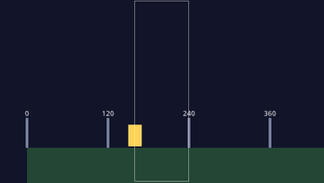
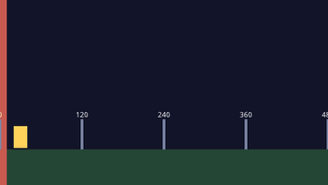
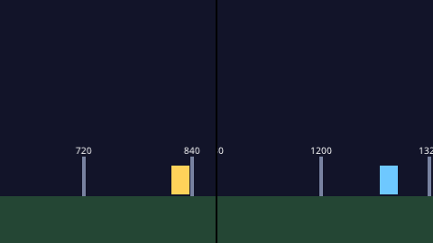
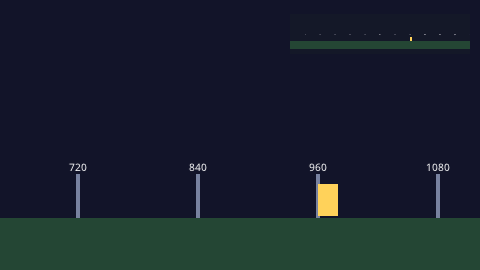

# Cameras

A camera decides which part of the world is on screen. A game that fits on one screen needs none; a game with a world larger than the screen puts a camera on the player, and screen shake needs a camera to move.

The pictures on this page come from the programs printed with them, in [`bindings/candela/docs/gallery/cameras`](https://github.com/FizzWizZleDazzle/Drift/tree/main/bindings/candela/docs/gallery/cameras); each runs in the browser from the link under it.

## The default view

Until you spawn a `Camera` entity there is none. The game draws through a fixed default view: world position (0, 0) is the top-left of the screen and one world unit is one logical pixel, so a 960 by 540 game shows the world from (0, 0) to (960, 540). Every example in this book that fits on one screen works this way.

Nothing can move the default view. Scrolling, zoom, [screen shake](effects.md#screen-shake) and `CameraFollow` all need a camera entity.

## A camera

A `Camera` entity looks at the world from its `Transform`: its position is the world point at the **center** of the screen. To get a camera that shows exactly what the default view shows, put it at the middle of the screen:

```rust
@resource
struct View { camera: Entity = Entity { .. } }

@system(schedule: Schedule::Startup)
fn setup(cmd: Commands, window: Window, view: View) {
    view.camera = cmd.spawn([at(window.width / 2.0, window.height / 2.0), Camera { .. }]);
}
```

Keep the `Entity` in a resource, as here, so other systems can shake it, move it, or convert positions through it. A camera spawned `at(0.0, 0.0)` without `CameraFollow` puts world (0, 0) in the middle of the screen, so everything you placed for the default view shifts right and down by half a screen.

| `Camera` field | Default | Meaning |
|----------------|---------|---------|
| `zoom` | 1.0 | Magnification: 2.0 shows the world twice as large, so half as much of it; 0.5 shows twice as much |
| `rotation` | 0.0 | Turns the view, in radians |
| `active` | true | False stops this camera drawing |
| `viewport` | `rect(0.0, 0.0, 1.0, 1.0)` | The part of the window it draws to: x, y, width and height, each 0 to 1 |
| `order` | 0 | Cameras draw from the lowest order up |
| `layer_mask` | every layer | The layers it draws; see `layer_mask([0, 3])` in [Sprites](sprites.md) |
| `target` | the window | A render target texture to draw into instead |
| `clear`, `clear_color` | false, black | Whether it clears its target first, and to what color |

Move the camera by writing its `Transform` from a system, or let `CameraFollow` move it.

## Following the player



`CameraFollow` moves the camera toward another entity every frame:

```rust
{{#include ../../gallery/cameras/follow/main.cdl:follow}}
```

| `CameraFollow` field | Default | Unit | What changing it does |
|----------------------|---------|------|-----------------------|
| `target` | none | `Entity` | The entity to follow. Without one, or once it is despawned, the camera stays where it is |
| `smoothing` | 5.0 | per second | How quickly the camera catches up. At 5 it closes about two thirds of the gap in a fifth of a second; 10 and up is nearly locked on, 2 is lazy |
| `offset` | (0, 0) | pixels | Aims this far from the target: `vec2(0.0, -65.0)` keeps the target in the lower part of the screen, for a platformer that wants to show what is above |
| `dead_zone` | (0, 0) | pixels | Half the size of a box around the point the camera aims at. While the target stays inside it the camera does not move; once it leaves on either axis the camera moves to center it again |

In the picture the box is the dead zone: the runner moves inside it with the camera still, and once out, the camera moves and lags behind by an amount set by `smoothing`. The follow camera starts where you spawn it and glides to the target from there, so spawn it at the target's position to start on it.

[Run it in the browser](../play/gallery/cameras/follow/).

<details>
<summary>The whole program</summary>

```rust
{{#include ../../gallery/cameras/follow/main.cdl:all}}
```

</details>

## Keeping the camera inside the level



`CameraBounds` stops the camera at the edges of a level, so the view never shows what lies past them:

```rust
{{#include ../../gallery/cameras/bounds/main.cdl:bounds}}
```

`area` is a world rect: x, y, width and height in pixels. Each frame, after `CameraFollow` has moved the camera, the camera is held so its whole view stays inside `area`. Where the area is smaller than the view on an axis, the camera centers on it there. A zero-size `area` (the default) holds nothing. Rotation is not taken into account, so a turned camera can show past the edges.

Screen shake runs after the bounds, so a shake at the edge of the level can show a few pixels past it.

[Run it in the browser](../play/gallery/cameras/bounds/).

<details>
<summary>The whole program</summary>

```rust
{{#include ../../gallery/cameras/bounds/main.cdl:all}}
```

</details>

## Screen and world positions

With a camera, a position on screen is no longer the same as a position in the world. `Input.mouse_world()` is the mouse through the main camera, which is what aiming and clicking on things need. `Camera2D` converts between the two through the main camera:

```rust
@system
fn aim(input: Input, view: Camera2D) {
    let target = view.screen_to_world(input.mouse_screen());   // the world point under the mouse
    let shown = view.visible();                                   // the world rect on screen
}
```

The `_in` versions, such as `screen_to_world_in(camera, p)`, `world_to_screen_in(camera, p)` and `visible_in(camera)`, do the same through any camera entity. Without a camera entity, screen and world positions are the same.

A HUD on `hud_layer()` is not drawn through any camera: it does not scroll, zoom or shake. See [UI and Score](ui-and-score.md).

## Zoom

Set `zoom` on the camera, or tween it smoothly with `tween().zoom_to(zoom, seconds, ease)` on the camera entity. Zoom keeps the camera's position at the center, so zooming in closes in on the middle of the screen. `CameraBounds` takes the zoom into account.

## Split screen



Give each camera a `viewport`, the part of the window it draws to, and an `order`:

```rust
{{#include ../../gallery/cameras/split/main.cdl:split}}
```

Each half shows half as much world as a full-window camera at the same zoom, because a viewport keeps one world pixel per screen pixel. The HUD covers the whole window. The first active camera that draws to the window is the main camera, the one `Camera2D` and `Input.mouse_world()` use.

[Run it in the browser](../play/gallery/cameras/split/).

<details>
<summary>The whole program</summary>

```rust
{{#include ../../gallery/cameras/split/main.cdl:all}}
```

</details>

## Render targets and minimaps



A camera can draw into a texture instead of the window. Make the texture with `assets.render_target(width, height)` (pixels), set it as the camera's `target`, then show it with a sprite, here as a minimap on the HUD:

```rust
{{#include ../../gallery/cameras/minimap/main.cdl:minimap}}
```

The minimap camera has a lower `order`, so it draws first and its texture is ready when the main camera's frame is drawn. Its `zoom` of 0.125 fits the level, 1440 pixels wide, into the texture's 180. `clear: true` with its own `clear_color` gives the map its dark background.

[Run it in the browser](../play/gallery/cameras/minimap/).

<details>
<summary>The whole program</summary>

```rust
{{#include ../../gallery/cameras/minimap/main.cdl:all}}
```

</details>

## Resolution and scale modes

The game draws at the logical resolution `width` and `height` in the `[window]` section of `drift.toml`. `scale_mode` decides how that fits the window:

```toml
[window]
width = 320
height = 180
scale_mode = "integer"
```

| Mode | Result |
|------|--------|
| `letterbox` | Keeps the aspect ratio; bars fill the rest. The default |
| `stretch` | Fills the window, distorting the aspect ratio |
| `integer` | Pixel perfect: scales by whole numbers |
| `expand` | Keeps pixels square and grows the logical size, so wider screens see more |

`Window` changes the mode and size while the game runs, and its `width` and `height` report the size in effect. It also sets the title, the background color, fullscreen and the mouse cursor. The background color is `clear_color` in `[render]`.

See [`Camera`](../reference/components.md#camera) and [`Camera2D`](../reference/resources.md#camera2d) for the reference entries.
