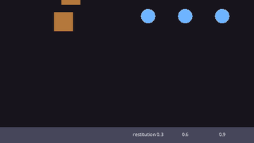
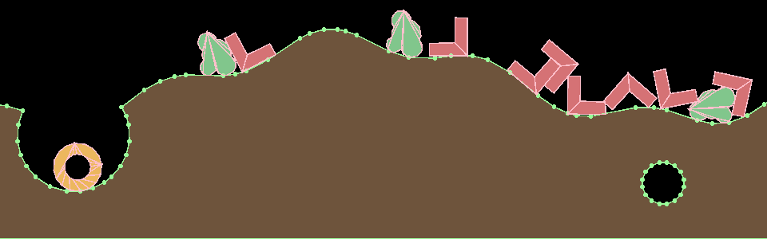

# Collisions and Physics

Drift simulates rigid bodies with Box2D. Give an entity a body and a collider, and the engine moves it, collides it and tells your systems what touched what. World units are pixels and +Y points down.

You do not need physics to move things; see [Movement](movement.md). Use it when things should collide, bounce, fall, stack or set off triggers.

## Bodies and colliders



What each part needs:

| You want | The entity needs |
|----------|------------------|
| Something that falls, collides and is pushed | `Transform`, `RigidBody`, a collider (`BoxCollider` or `CircleCollider`) and `Velocity` |
| A wall or floor that never moves | `Transform` and a collider, with no `RigidBody` |
| Gravity | `gravity` in the `[physics]` section of `drift.toml`; the default is too weak for pixel units |
| To hear about hits | Colliders on both entities, and a system taking `Contact<A, B>` |

The collider is the shape physics uses, and the `Rectangle`, `Circle` or `Sprite` is only the picture: make them the same size yourself, with `half_size` half the rectangle's `size`.

```toml
{{#include ../../gallery/collisions/fall/drift.toml:physics}}
```

```rust
{{#include ../../gallery/collisions/fall/main.cdl:bodies}}

{{#include ../../gallery/collisions/fall/main.cdl:contact}}
```

[Run it in the browser](../play/gallery/collisions/fall/).

<details>
<summary>The whole program</summary>

```rust
{{#include ../../gallery/collisions/fall/main.cdl:all}}
```

</details>

| `BodyKind` | Behavior |
|------------|----------|
| `Dynamic` | Falls, collides and is pushed. The default |
| `Kinematic` | Moves only by its `Velocity`; pushes dynamic bodies and is not pushed |
| `Static` | Never moves |

A dynamic body moves on screen only when its entity also has a `Velocity`, as the crates above do. Without one, the entity stays where it was spawned, with no error. Give it one in the bundle, or let a component of your own bring it with `@component(requires: [Velocity])`.

| `RigidBody` field | Default | Meaning |
|-------------------|---------|---------|
| `kind` | `BodyKind::Dynamic` | See the table above |
| `fixed_rotation` | false | True keeps the body upright, for characters |
| `gravity_scale` | 1.0 | Multiplies gravity for this body; 0 floats, -1 falls up |
| `linear_damping`, `angular_damping` | 0.0, 0.0 | Slow its motion and its spin over time, per second; 0.5 to 2 for things moving through water |

| Collider field | Default | Meaning |
|----------------|---------|---------|
| `half_size` (box) | (16, 16) | Half the width and height, in pixels |
| `radius` (circle) | 16.0 | In pixels |
| `offset` | (0, 0) | Moves the shape from the entity's position, in pixels |
| `sensor` | false | True notices overlaps without pushing anything; see [Collisions and sensors](#collisions-and-sensors) |
| `density` | 1.0 | Mass per square pixel; heavier bodies push lighter ones aside |
| `friction` | 0.3 | 0 is ice; 1 grips |
| `restitution` | 0.0 | Bounciness, 0 to 1: the share of its speed a bounce keeps |
| `category`, `mask` | 1, 65535 | Which colliders touch; see [Collision filtering](#collision-filtering) |

The physics world measures lengths in meters of `pixels_per_meter` pixels, 32 unless `[physics]` sets another; see [Gravity and scale](#gravity-and-scale). Bodies can move as fast as 400 meters a second, 12800 pixels a second at the default.

The body is created at the end of the frame its components are added. Changing a field of the `RigidBody` or the collider later makes the body again with the new settings, where it is and at the speed it has: set `gravity_scale` to 0 for a power-up that makes the player float, or switch `kind` to `Static` to freeze a crate in place.

## Moving bodies

On a dynamic body, `Velocity` is the body's velocity: read it to see how fast the body moves, and write it to set the speed directly, as a character controller does:

```rust
@system
fn run(input: Input, players: (Player, Velocity)[]) {
    for (_, v) in players {
        v.linear = vec2(input.axis("run") * 220.0, v.linear.y);
    }
}
```

For pushes, use `Physics`: `apply_impulse(e, i)` changes velocity at once (a jump, a hit), and `apply_force(e, f)` acts over the frame (thrust, wind). `apply_torque` and `apply_angular_impulse` spin a body. Physics moves the `Transform`; writing a dynamic body's `Transform` yourself teleports it.

```rust
@system
fn knockback(hit: Contact<Player, Enemy>, physics: Physics) {
    physics.apply_impulse(hit.a, hit.normal * -40000.0);   // away from the enemy
}
```

Mass is density times area in pixels, so a 32 by 32 box of density 1 weighs 1024: impulses and forces in pixel units are large numbers. An impulse of `mass * speed` changes the speed by `speed` pixels per second.

## Gravity and scale

Gravity starts from `[physics]` in `drift.toml`, in pixels per second squared. The default is small for pixel units, so most games set it:

```toml
[physics]
gravity = [0, 900]
pixels_per_meter = 32
```

A top-down game sets `[0, 0]`. `Physics` changes it while running with `set_gravity`, and `RigidBody.gravity_scale` scales it for one body.

`pixels_per_meter` tells the physics world how big a meter is on screen. Box2D tunes its tolerances in meters: how far shapes may overlap before it pushes them apart, how close two shapes come before their contact starts, how slowly a body moves before it sleeps, and the top speed of 400 meters a second. Positions, speeds, gravity, mass and impulses stay in pixels whatever the scale. The default, 32, suits objects from a few pixels to a few hundred across; a game of much larger objects can raise it. It is read when the game starts.

## Colliders from images

A `TextureCollider` takes its shape from the entity's `Sprite`: every pixel whose alpha is at least `threshold` is solid, and the collider follows the outline of those pixels, holes included. Use it for rocks, characters and terrain whose shape a box or circle does not fit:

```rust
@system(schedule: Schedule::Startup)
fn setup(cmd: Commands, assets: Assets) {
    // A ring: a disc with a hole in it.
    let img = assets.create_image(64, 64, rgba(0, 0, 0, 0));
    img.circle(vec2(32.0, 32.0), 30.0, rgb(230, 180, 60));
    img.fill_circle(vec2(32.0, 32.0), 16.0, rgba(0, 0, 0, 0));
    let ring = img.to_texture();
    for i in range(10) {
        cmd.spawn([at(100.0 + float(i) * 70.0, 50.0), Sprite { image: ring, .. },
                   RigidBody { .. }, TextureCollider { .. }, Velocity { .. }]);
    }
    // Ground from a picture: no RigidBody, so it is static.
    cmd.spawn([at(0.0, 400.0), Sprite { image: texture("ground.png"), pivot: vec2(0.0, 0.0), .. },
               TextureCollider { .. }]);
}
```



The debug drawing (`physics.set_debug_draw(true)`, or F3 with [the debug overlay](debugging.md#the-debug-overlay-in-every-build)) shows what the collider is made of. Static ground gets the outlines themselves, which are cheap even for a large picture with caves in it; they push bodies out from the empty side only, so a body that starts inside solid ground stays there. A dynamic or kinematic body, or a sensor, gets the solid area cut into convex pieces of at most 8 corners, since that is what Box2D can move.

The outline is simplified: `tolerance` is how far, in image pixels, it may stray from the pixels, so a sprite becomes a few dozen points rather than one per pixel. Raise it for fewer points, lower it to follow the pixels closely. Solid specks and holes smaller than `min_area` square pixels are dropped, so a stray pixel does not become a collider.

The collider follows the sprite's `frame`, `pivot`, `flip_x` and `flip_y` and the `Transform`'s scale as they are when the body is made. Tracing happens once per image, frame and settings: a hundred enemies showing one sprite share one tracing. For an animated sprite whose shape changes from frame to frame, set `follow_sprite: true` to make the collider again whenever the frame, anchor, a flip or the scale changes; each change makes a new body, so leave it off when one shape fits every frame.

### Changing the ground

Terrain you carve holes into is an `Image` you keep, change, write into its texture, and then rebuild the shapes from:

```rust
@resource
struct Ground { image: Image = Image { .. }, texture: Texture = Texture { .. } }

@message
struct Explosion { at: Vec2 = Vec2 { .. } }

@system
fn crater(blast: Explosion, ground: Ground, physics: Physics) {
    // The ground sprite's top-left corner is at (0, 400).
    ground.image.fill_circle(blast.at - vec2(0.0, 400.0), 40.0, rgba(0, 0, 0, 0));
    ground.texture.update(ground.image);
    physics.rebuild_shapes(ground.texture, ground.image);
}
```

`rebuild_shapes` traces the whole image again, so call it when the pixels change rather than every frame. Passing the image saves reading the texture back from the GPU; with `Image {}` it reads the texture instead.

`texture_outlines` and `texture_pieces` return the outlines and pieces a collider with given settings would get, in image pixels from the frame's top-left corner, to draw or test them yourself.

## Collisions and sensors

Collisions arrive as events, filtered by the components on the two entities. A system that takes one `Contact<A, B>` runs once for each collision that started this frame between an entity with `A` and one with `B`, with `a` and `b` in that order:

```rust
@system
fn take_hits(hit: Contact<Player, Spike>, health: Lookup<Health>) {
    if health.get(hit.a) is Some(h) {
        h.hp -= 1;
    }
}
```

Take a list, `Contact<Player, Spike>[]`, to see the frame's collisions at once.

A collider with `sensor: true` detects overlap without pushing anything: pickups, trigger zones, checkpoints. `Overlap<A, B>` is a sensor overlap that started this frame, whichever of the two is the sensor. `ContactEnd` and `OverlapEnd` report the ends, for "standing on" and "inside the zone" logic.

A sensor with no `RigidBody`, such as a coin, notices dynamic bodies only: a kinematic or static body passes through it unreported. Give the player a dynamic body (with `gravity_scale: 0.0`, or `gravity = [0, 0]` in a top-down game, if it should not fall) to collect things. A kinematic sensor, such as a bullet, reports the dynamic bodies it passes through, and a sensor on a dynamic body, such as the bird in Flappy Bird, reports kinematic ones too.

`Contact` also carries `point` and `normal`, the first contact point and the direction from `a` to `b`. A player whose contact normal with the ground points down, `hit.normal.y > 0.5`, has landed on top of it rather than hit it from the side.

## Collision filtering

Each collider has a `category` and a `mask`, both bit sets. Two colliders collide when each one's category is in the other's mask:

```rust
// 1 = player, 2 = enemy, 4 = player bullet
BoxCollider { half_size: vec2(8.0, 8.0), category: 4, mask: 2, .. }   // bullets hit enemies only
```

The default category is 1 and the default mask is every bit.

## Queries

`Physics` asks the world about shapes without spawning anything:

- `raycast(origin, direction, distance)` returns the first hit as a `RayHit` with `hit`, `entity`, `point`, `normal` and `fraction`. Sensors count as hits.
- `raycast_mask(origin, direction, distance, mask)` sees only colliders whose `category` is in `mask`, such as walls for line of sight.
- `overlap_point(p)` returns the entities whose colliders contain a point: what is under the mouse.
- `overlap_circle(center, radius)` returns the entities whose colliders touch a circle: an explosion's reach. `overlap_circle_mask` takes a mask too.
- `overlap_rect(r)` returns the entities whose colliders' bounding boxes touch a rect.

```rust
@system
fn line_of_sight(guard: (Guard, Transform), physics: Physics,
                 players: (Entity, Player, Transform)[]) {
    let (_, eye) = guard;
    for (player, _, t) in players {
        let to = t.position - eye.position;
        let ray = physics.raycast(eye.position, to.normalized(), to.length());
        if ray.hit && ray.entity == player {
            log("spotted");
        }
    }
}
```

`set_debug_draw(true)` outlines every collider over the game.

### Without colliders

Things that only need "what is near here", such as pickups that home in on the nearest player or enemies that alert their neighbours, do not need physics bodies. Give them a `SpatialBounds` and ask the `Spatial` resource:

```rust
@system(schedule: Schedule::Startup)
fn spawn_bats(cmd: Commands) {
    cmd.spawn([at(300.0, 120.0), Bat { .. }, SpatialBounds { half_size: vec2(8.0, 8.0), .. }]);
}

@system
fn alert(bat: (Bat, Transform, Entity), spatial: Spatial, cmd: Commands) {
    let (_, t, me) = bat;
    for other in spatial.in_radius(t.position, 120.0) {
        if other.id != me.id {
            cmd.insert(other, Alerted {});
        }
    }
}
```

`in_rect(r)` and `in_radius(center, radius)` return the entities whose bounds touch the area, and `nearest(p, max_distance, ignore)` the closest one, or `Entity {}`. The index is rebuilt at the start of every frame from where the entities were then.

## Joints

A `Joint` joins an entity's body to another entity's body, or pins it to the world when `target` is left empty. Both entities need a body; the joint is made once they exist.

```rust
@system(schedule: Schedule::Startup)
fn pendulum(cmd: Commands) {
    // A weight on a 60 pixel rod, hanging from the point (500, 50).
    cmd.spawn([
        at(560.0, 50.0),
        Circle { radius: 8.0, .. },
        RigidBody { .. },
        CircleCollider { radius: 8.0, .. },
        Velocity { .. },
        Joint { kind: JointKind::Distance, target_anchor: vec2(500.0, 50.0), .. },
    ]);
}
```

| `JointKind` | Does |
|-------------|------|
| `Distance` | Keeps the anchors `length` apart (0: the distance they start at). With `stiffness` it is a spring; with `max_length` above `min_length` it is a rope that can go slack |
| `Revolute` | A hinge: the anchors stay together and the bodies turn about them. `limit` with `lower` and `upper` (radians) bounds the angle; `motor` turns it, as on a wheel or a door |
| `Prismatic` | A slider along `axis`: lifts, pistons. `limit` bounds the travel |
| `Weld` | Glues the bodies together; with `stiffness` it bends |

`anchor` is on this entity and `target_anchor` on the target, each in its body's local space (without a target, `target_anchor` is a point in the world). `collide_connected` lets the two joined bodies collide. Changing a field makes the joint again; removing the component removes it. A chain is one joint per link, each targeting the link before it.

See [Engine Components](../reference/components.md#rigidbody) and [`Physics`](../reference/resources.md#physics) for every field and method. [Platformer](../examples/platformer.md) and [Breakout](../examples/breakout.md) are built on bodies, contacts and sensors.
