# Particles and Effects

Particles, trails, 2D lights and screen effects make a game feel alive. All of them are components or calls on `Effects`, and the engine runs them; your systems only start and stop them.

Every picture on this page comes from the program printed under it, a small game in [`bindings/candela/docs/gallery/effects`](https://github.com/FizzWizZleDazzle/Drift/tree/main/bindings/candela/docs/gallery/effects). Copy the program into a game folder's `main.cdl` and it runs the same way; each also runs in the browser, linked under its picture. `scripts/gallery.js` makes the pictures again from those programs.

| Effect | Needs first |
|--------|-------------|
| [Screen shake](#screen-shake) | A `Camera` entity, kept in a resource |
| [Flash](#flash) and [fade](#fade) | Nothing |
| [Post effects](#post-effects) | Nothing |
| [Particle emitters](#particle-emitters) | A `Transform` on the entity |
| [Bursts](#bursts) | Nothing |
| [Trails](#trails) | A `Transform` that moves |
| [Lights](#lights) | A `[lighting]` section in `drift.toml` |

Units used throughout: positions, sizes and distances are in world pixels, times in seconds, angles in radians (0 points along +x, and angles grow clockwise on screen because y points down, so straight up is -1.57), and colors are `rgb(0-255, ...)` or `Color` fields from 0 to 1.

## Screen shake

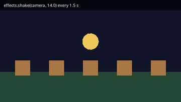

`effects.shake(camera, intensity)` shakes a camera entity. **There is no camera until you spawn one**: without a `Camera` entity the game draws through a default view that nothing can move, so a shake has nothing to shake and does nothing, with no error.

1. Spawn a `Camera` in a Startup system. Put it at the middle of the screen, `at(window.width / 2.0, window.height / 2.0)`, and the screen shows what it showed without one: world (0, 0) stays at the top-left.
2. Keep the camera's `Entity` in a resource, so other systems can name it.
3. Call `effects.shake(camera, intensity)` when something hits.

```rust
{{#include ../../gallery/effects/shake/main.cdl:camera}}

{{#include ../../gallery/effects/shake/main.cdl:shake}}
```

| Parameter | Unit | Meaning |
|-----------|------|---------|
| `camera` | `Entity` | An entity with a `Camera`. Any other entity, or `Entity { .. }`, is ignored |
| `intensity` | pixels | How far the view swings at the start. 3 is a nudge, 8 a hit, 15 and up an explosion |

The shake dies away by itself: the swing shrinks to about a third every fifth of a second, so it is too small to see after about a second. A new shake replaces the one running, so shaking again before it settles starts it over at the new intensity. When it settles the camera is back where it was; your systems and `CameraFollow` see the camera's own position the whole time, never the shaken one.

The HUD (`hud_layer()`) does not shake, because it is not drawn through a camera. With several cameras, shake each one you want moving; the [`Shake` message](building-blocks.md) of `drift/gameplay` shakes every camera at once, and it also needs a camera to exist. Its default `intensity` is 0.4 pixels, too small to see; send `Shake { intensity: 8.0 }`.

[Run it in the browser](../play/gallery/effects/shake/).

<details>
<summary>The whole program</summary>

```rust
{{#include ../../gallery/effects/shake/main.cdl:all}}
```

</details>

## Flash

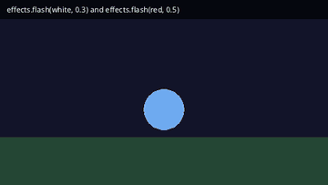

`effects.flash(color, seconds)` covers the screen with `color` at once and fades it away over `seconds`. It needs no camera.

```rust
{{#include ../../gallery/effects/flash/main.cdl:flash}}
```

| Parameter | Unit | Meaning |
|-----------|------|---------|
| `color` | `Color` | The flash color. The flash starts as solid `color` whatever its alpha; a shorter `seconds` makes it lighter |
| `seconds` | seconds | How long it takes to fade back. 0.1 to 0.3 for a hit, 0.5 and more for a lightning strike. 0 shows nothing |

[Run it in the browser](../play/gallery/effects/flash/).

<details>
<summary>The whole program</summary>

```rust
{{#include ../../gallery/effects/flash/main.cdl:all}}
```

</details>

## Fade


`effects.fade_to(color, amount, seconds)` moves the screen `amount` of the way to `color` over `seconds`, then holds it there until the next call. Fade out with `amount` 1.0, back in with 0.0, and dim a pause screen with something in between.

```rust
{{#include ../../gallery/effects/fade/main.cdl:fade}}
```

| Parameter | Unit | Meaning |
|-----------|------|---------|
| `color` | `Color` | The color to fade toward, usually black |
| `amount` | 0 to 1 | 0 is the game as drawn, 1 is solid `color` |
| `seconds` | seconds | How long the change takes; 0 jumps there at once |

The fade ignores the color's alpha: `amount` alone sets how far the screen goes. Flashes and fades share one screen layer. A flash during a fade replaces the fade's color and ends at 0, so the screen comes back from a held fade; fade again after the flash if you want it dark. The HUD is drawn after the fade, so a faded screen still shows the score; hide HUD text yourself if the fade should cover it.

[Run it in the browser](../play/gallery/effects/fade/).

<details>
<summary>The whole program</summary>

```rust
{{#include ../../gallery/effects/fade/main.cdl:all}}
```

</details>

## Post effects

Post effects run on the whole picture after every camera has drawn and before the HUD, so the HUD stays sharp. They need no camera. Each call on `Effects` adds one effect, starts it at once, and returns an `Effect` you can keep to change or remove it later. Here is the scene every picture below starts from:


| Call | Picture | Parameters |
|------|---------|------------|
| `bloom(threshold, intensity)` | 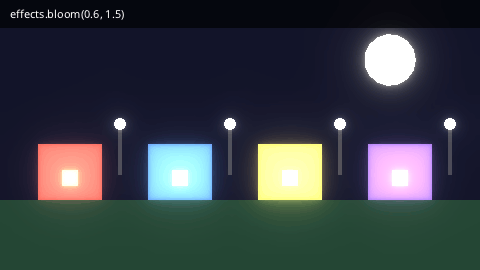 | `threshold` 0 to 1: how bright a pixel must be to glow (0.7 default; lower makes more glow). `intensity`: glow strength, 1.0 default, 2 and up for neon |
| `vignette(intensity, radius)` | 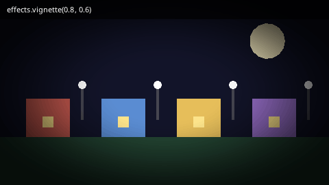 | `intensity` 0 to 1: how dark the edges get. `radius`: how far from the center the darkening is full (0.75 default; smaller closes in) |
| `crt(curvature, scanlines)` | 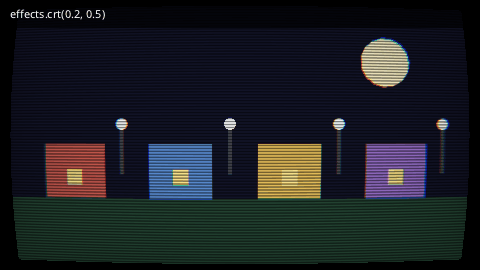 | `curvature`: how much the screen bulges; 0 is flat. `scanlines` 0 to 1: how dark the lines are |
| `grayscale(amount)` | 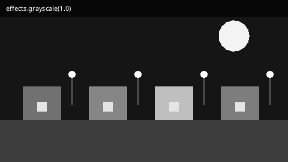 | `amount` 0 to 1: 1 is fully gray, 0.5 half way |
| `sepia(amount)` | 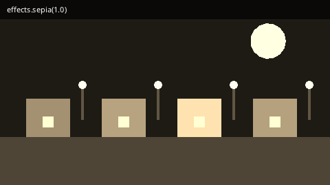 | `amount` 0 to 1, like `grayscale` |
| `pixelate(size)` | 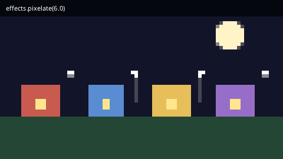 | `size`: block size in screen pixels, 2 and up |
| `blur(radius, iterations)` | 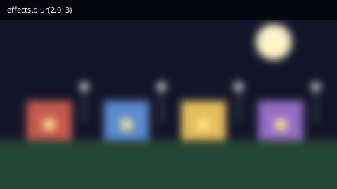 | `radius`: how far each pass spreads, 1.0 default. `iterations`: passes, 2 default; each one widens and smooths it |
| `add(ColorGrading { .. })` | 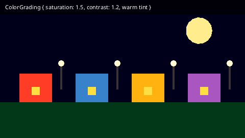 | `brightness`, `contrast`, `saturation`: 1.0 leaves the picture alone. `tint`: multiplies every color |

The bloom call, for example, is one line in a Startup system:

```rust
{{#include ../../gallery/effects/bloom/main.cdl:effect}}
```

<details>
<summary>The whole program (the other pictures change only that line)</summary>

```rust
{{#include ../../gallery/effects/bloom/main.cdl:all}}
```

</details>

Every program runs in the browser: [bloom](../play/gallery/effects/bloom/), [vignette](../play/gallery/effects/vignette/), [CRT](../play/gallery/effects/crt/), [grayscale](../play/gallery/effects/grayscale/), [sepia](../play/gallery/effects/sepia/), [pixelate](../play/gallery/effects/pixelate/), [blur](../play/gallery/effects/blur/), [color grading](../play/gallery/effects/color_grading/).

### Every setting, and changing effects later

The short calls set the main parameters. For every setting, pass the settings struct to `effects.add`; fields you leave out keep their defaults:

| Struct | Fields and defaults |
|--------|---------------------|
| `Bloom` | `threshold` 0.7, `soft_knee` 0.5 (0 cuts off hard at the threshold, 1 eases in), `intensity` 1.0, `radius` 1.0, `levels` 5 (1 to 8; more spreads the glow wider), `tint` white |
| `ColorGrading` | `brightness` 1.0, `contrast` 1.0, `saturation` 1.0, `tint` white, `lut` (a lookup-table texture: a strip of N slices of N x N), `lut_strength` 1.0 |
| `Blur` | `radius` 1.0, `iterations` 2 |
| `Pixelate` | `size` 6.0 |
| `Grayscale`, `Sepia` | `amount` 1.0 |
| `Vignette` | `intensity` 0.6, `radius` 0.75, `softness` 0.45 (how far inside `radius` it starts), `color` black |
| `Crt` | `curvature` 0.15, `scanlines` 0.35, `scanline_spacing` 3.0 (pixels), `chromatic_aberration` 1.5 (pixels the colors split at the edges), `vignette` 0.3 |

Keep the `Effect` in a resource to change it while the game runs:

```rust
@resource
struct Looks { glow: Effect = Effect { .. } }

@system(schedule: Schedule::Startup)
fn looks(effects: Effects, looks: Looks) {
    looks.glow = effects.add(Bloom { threshold: 0.5, intensity: 1.4, levels: 6, .. });
}

@system
fn power_up_glow(input: Input, looks: Looks) {
    if input.key_pressed(Key::G) {
        looks.glow.set(Bloom { threshold: 0.3, intensity: 2.5, .. });   // replaces every setting
        looks.glow.set_enabled(!looks.glow.enabled());
    }
}
```

- `set(settings)` replaces all the settings, so fields you leave out go back to their defaults. It takes the same struct the effect was made with; a different kind logs a warning and changes nothing.
- `set_enabled(on)` switches the effect off and on and keeps its settings; `remove()` deletes it.
- Each kind has its own place in the chain, whatever order you add them in: bloom 100, color grading 200, blur 300, pixelate 400, grayscale and sepia 500, vignette 600, CRT 700, and the flash and fade layer 900. Lower orders run first. `effects.add_at(settings, order)` adds one at another place, and `set_order(order)` moves it.
- Adding the same kind twice runs it twice. Add effects once, in a Startup system, and switch them with `set_enabled`; adding one every frame stacks a new effect each frame.
- `effects.add` with a struct that is not one of the eight logs "Candela: Vec2 is not a post effect" (with the struct's name) and returns an `Effect` that does nothing.

## Particle emitters

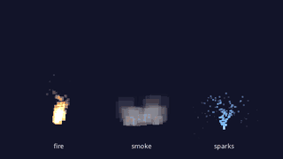

A `ParticleEmitter` component emits particles from its entity's `Transform` for as long as `playing` is true. Give the entity a position with `at(x, y)`; the emitter moves with it.

```rust
{{#include ../../gallery/effects/particles/main.cdl:fire}}
```

[Run it in the browser](../play/gallery/effects/particles/).

<details>
<summary>The whole program</summary>

```rust
{{#include ../../gallery/effects/particles/main.cdl:all}}
```

</details>

Every field, with its default. A pair of `_min` and `_max` picks a random value between them for each particle; a `_max` of 0.0 means "the same as the minimum".

| Field | Default | Unit | What changing it does |
|-------|---------|------|-----------------------|
| `rate` | 20.0 | per second | More particles; 0 makes only bursts |
| `lifetime_min`, `lifetime_max` | 0.5, 1.5 | seconds | Longer trails of particles, further travel |
| `speed_min`, `speed_max` | 20.0, 60.0 | pixels per second | Faster spread |
| `angle_min`, `angle_max` | 0.0, 6.2831853 | radians | The direction range; the default is every direction. -2.0 to -1.15 is a cone pointing up |
| `size_start`, `size_end` | 6.0, 1.0 | pixels across | Size at birth and at death, blended over the life |
| `size_start_max`, `size_end_max` | 0.0, 0.0 | pixels | Upper end of a random size range |
| `color_start`, `color_end` | white, clear white | `Color` | Color at birth and at death; end with alpha 0 to fade out |
| `gravity` | (0, 0) | pixels per second squared | Pulls every particle; negative y rises, like heat |
| `drag` | 0.0 | per second | Slows particles: each frame speed shrinks by `drag * dt`. 0.5 to 1 for smoke |
| `max_particles` | 256 | count | The most alive at once; new ones wait for old ones to die |
| `blend` | `Blend::Alpha` | | `Blend::Additive` makes overlaps brighter, for fire, magic and sparks |
| `texture`, `frame` | none | | Draws each particle with an image (or the `frame` part of it); without one each particle is a soft square |
| `shape` | `EmitShape::Point` | | Where particles start: `Point`, `Circle` and `Ring` (radius `shape_radius`), `Box` (half size `shape_extents`), `Line` (`shape_extents` is the direction and half length) |
| `shape_radius`, `shape_extents` | 0.0, (0, 0) | pixels | See `shape` |
| `rotation_min`, `rotation_max` | 0.0, 0.0 | radians | Each particle's turn at birth; matters with a `texture` |
| `spin_min`, `spin_max` | 0.0, 0.0 | radians per second | Turning while alive |
| `duration` | -1.0 | seconds | How long it emits; -1 is forever |
| `looping` | true | | With a `duration`, false stops for good when it runs out |
| `playing` | true | | Write it to stop and start emitting; live particles finish their lives |
| `prewarm` | 0.0 | seconds | Starts the emitter as if it had already run this long, so a torch is lit on the first frame |
| `local` | false | | True keeps live particles moving with the emitter, for engine flames on a ship |
| `inherit_velocity` | 0.0 | 0 to 1 | The share of the emitter's own motion new particles keep |
| `bounds` | none | world rect | Particles stop at its edges; a zero-size rect means no bounds |
| `z` | 10.0 | | Draw order among sprites and shapes |
| `seed` | 0 | | A seed for the particles' random numbers; 0 picks one |
| `bursts` | `[]` | | Bursts on a schedule; see below |

`bursts` fire many particles at once at set times in the emitter's run: `Burst { time: 0.0, count: 30, cycles: 3, interval: 0.5 }` fires 30 particles three times, half a second apart (`cycles: 0` repeats forever). `effects.restart_particles(emitter)` starts an emitter's run over, bursts and all, for a fountain that spurts again on a key.

Turn an emitter on and off by writing `playing` from a system that runs once per emitter:

```rust
@system
fn thrusters(ship: (Ship, ParticleEmitter), input: Input) {
    let (_, emitter) = ship;
    emitter.playing = input.action_held("thrust");
}
```

Pitfalls:

- An emitter on an entity with no `Transform` emits at (0, 0), the top-left of the default view. Spawn it with `at(x, y)`.
- A `ParticleEmitter` with `looping: false` and a `duration` stops emitting but the entity stays. Despawn it yourself, or use `effects.burst` for a one-off.

## Bursts

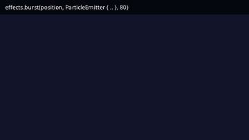

For a one-off puff, an explosion or a pickup sparkle, call `effects.burst(position, emitter, count)`. It spawns an emitter at `position`, fires `count` particles at once, and removes it when the last one dies, so nothing is left to clean up. The `ParticleEmitter` you pass is the look of the particles; its `rate`, `duration` and `looping` are ignored, and `max_particles` is raised to `count` when it is smaller.

```rust
{{#include ../../gallery/effects/burst/main.cdl:burst}}
```

To burst where something was hit, read its position in the collision system:

```rust
@system
fn explode(hit: Contact<Bullet, Rock>, places: Lookup<Transform>, effects: Effects) {
    if places.get(hit.b) is Some(t) {
        effects.burst(t.position, ParticleEmitter {
            speed_min: 80.0, speed_max: 220.0, lifetime_max: 0.6,
            color_start: rgb(255, 240, 200), color_end: rgba(255, 80, 0, 0), ..
        }, 40);
    }
}
```

[Run it in the browser](../play/gallery/effects/burst/).

<details>
<summary>The whole program</summary>

```rust
{{#include ../../gallery/effects/burst/main.cdl:all}}
```

</details>

## Trails


A `Trail` leaves a fading ribbon behind an entity as its `Transform` moves: bullets, swords, comets. Any movement counts, whether a `Velocity`, a tween or a system writing the position.

```rust
{{#include ../../gallery/effects/trail/main.cdl:trail}}
```

| Field | Default | Unit | What changing it does |
|-------|---------|------|-----------------------|
| `width` | 4.0 | pixels | Thickness at the head |
| `lifetime` | 0.5 | seconds | How long each point lasts, so how long the ribbon is |
| `color_start`, `color_end` | white, clear white | `Color` | Color at the head and at the tail |
| `min_distance` | 2.0 | pixels | How far the entity moves before a new point; larger is cheaper and more angular |
| `max_points` | 64 | count | Caps the ribbon; a fast entity with a long `lifetime` may need more |
| `z` | -1.0 | | Draw order; below 0 draws behind shapes at z 0 |

A trail on an entity that stands still shows nothing.

[Run it in the browser](../play/gallery/effects/trail/).

<details>
<summary>The whole program</summary>

```rust
{{#include ../../gallery/effects/trail/main.cdl:all}}
```

</details>

## Lights

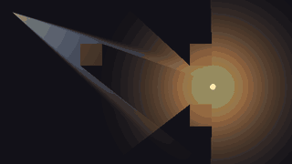

Lighting is off until `drift.toml` has a `[lighting]` section. With it, the whole scene starts at the `ambient` color and each light adds to it:

```toml
{{#include ../../gallery/effects/lights/drift.toml:lighting}}
```

| Key | Default | Meaning |
|-----|---------|---------|
| `ambient` | `[0.08, 0.08, 0.12]` | The light everywhere, each channel 0 to 1. `[1, 1, 1]` is full daylight, where lights change nothing |
| `enabled` | `true` | `false` keeps the section but switches lighting off |
| `layer_mask` | every layer | Which cameras' layers are lit |
| `resolution_scale` | 1.0 | Size of the light map relative to the screen; 0.5 is cheaper and softer |

Give an entity a `PointLight` to light everything around it, or a `SpotLight` for a cone. A `LightOccluder` blocks light and casts a shadow:

```rust
{{#include ../../gallery/effects/lights/main.cdl:occluder}}

{{#include ../../gallery/effects/lights/main.cdl:lights}}
```

[Run it in the browser](../play/gallery/effects/lights/).

<details>
<summary>The whole program</summary>

```rust
{{#include ../../gallery/effects/lights/main.cdl:all}}
```

</details>

| `PointLight` and `SpotLight` field | Default | Unit | Meaning |
|------------------------------------|---------|------|---------|
| `color` | white | `Color` | The light's color |
| `intensity` | 1.0 | | Brightness; 1.5 to 2 for a strong lamp |
| `radius` | 200.0 (point), 300.0 (spot) | pixels | How far it reaches |
| `falloff` | 2.0 | | 1 fades evenly to the edge; more keeps a tight bright core |
| `shadows` | true | | Whether occluders block it |
| `layer_mask` | every layer | | Cameras sharing a layer with it see it |
| `direction` (spot) | 0.0 | radians | Where the cone points, added to the entity's rotation; 0 is +x |
| `angle` (spot) | 0.8 | radians | The whole width of the cone |
| `softness` (spot) | 0.2 | 0 to 1 | 0 is a hard edge, 1 fades from the middle |

| `LightOccluder` field | Default | Meaning |
|-----------------------|---------|---------|
| `shape` | `OccluderShape::Box` | `Box` (`half_size`), `Circle` (`radius`), `Polygon` (`points`, up to 16, in the entity's space) or `FromCollider`, the shape of the entity's collider |
| `half_size` | (16, 16) | Half the box, in pixels; match it to the sprite |
| `radius` | 16.0 | The circle's radius in pixels |
| `offset` | (0, 0) | Moves the shape from the entity's position |
| `shadow_self` | false | False keeps the occluder's own area lit |

Change lighting while the game runs with `effects.set_ambient(color)`, for a day and night cycle or a room whose lights go out, and `effects.set_lighting(on)`.

Pitfalls:

- Without a `[lighting]` section, lights draw nothing and the scene is unlit. `set_ambient` and `set_lighting` then log "lighting is off; add a [lighting] section to drift.toml" once.
- Light only darkens the scene or leaves it as it is: a sprite under full white light shows its own colors, never brighter. For a glowing light source, pair the light with an additive sprite and bloom.
- The HUD is not lit.

The [Effects Showcase](../examples/effects.md) puts emitters, bursts, flashes, post effects, a trail and tweens on one screen. See [`ParticleEmitter`](../reference/components.md#particleemitter) and [`Effects`](../reference/resources.md#effects) for the reference entries.
