# Procedural Animation

Procedural animation poses a character from code every frame instead of playing frames someone drew: legs that reach for the ground, a head that turns toward what it watches, a tail that swings behind, a body that breathes. You build the character from parts, link the parts with `Parent`, and move them with the helpers on this page.

Everything here comes with `import "drift" { * };`. Angles are radians from the +x axis, and grow clockwise on screen, because y points down.

Each animation on this page comes from the program printed under it, a small game in [`bindings/candela/docs/gallery/animation`](https://github.com/FizzWizZleDazzle/Drift/tree/main/bindings/candela/docs/gallery/animation). Copy the code into a game folder and it moves the same way; every one also runs in the browser, linked under its picture. `scripts/gallery.js` makes the animations again from those programs.

| Technique | Animation |
|-----------|-----------|
| [Pivots](#pivots) | A sprite turning around its center, its end and its edge |
| [Rigs](#rigs) | An arm of three parts, and its mirror image |
| [Turning toward a target](#turning-toward-a-target) | `look_at` against `rotate_towards` with two turn speeds |
| [Oscillators and wobble](#oscillators-and-wobble) | Bobbing, circling, breathing and hovering |
| [Squash and stretch](#squash-and-stretch) | A bouncing ball with and without |
| [Springs](#springs) | `Spring`, `Spring2` and `AngleSpring` chasing a target |
| [Stiffness and damping](#stiffness-and-damping) | One spring, six settings |
| [Secondary motion](#secondary-motion) | Antennae and ears lagging on springs |
| [Two-bone IK](#two-bone-ik) | Arms reaching for the cursor, bent either way |
| [IK chains](#ik-chains) | Tentacles with and without joint limits |
| [Ropes, tails and hair](#ropes-tails-and-hair) | Hanging chains and a bridge hit by a ball |
| [Tail stiffness](#tail-stiffness) | Tails from loose to stiff |
| [Stepping feet](#stepping-feet) | Walkers with three step distances |
| [Tweens on a key](#tweens-on-a-key) | A jump with a spin, and a cancel |
| [The creature](#walkthrough-the-creature) | All of it in one lizard |

## Parts and pivots

Each part is an entity with a `Sprite` (or a `Rectangle` or `Circle`) whose `pivot` sits on its joint, so it turns around the joint. Parts that ride on another part get it as their `Parent`, and their `Transform` counts from it. See [Parts that move together](sprites.md) for building a rig; this page is about moving one.

Two ways to drive a part:

- **Local**: set the child's `Transform.rotation` relative to its parent. Good for joints that swing on their own: a wagging ear, a breathing chest.
- **World**: work out where the part belongs in world space (an IK solver, a rope, a foot) and assign its `GlobalTransform`, or keep the part as a root and set its `Transform`. The engine works out the local `Transform` for you.

### Pivots

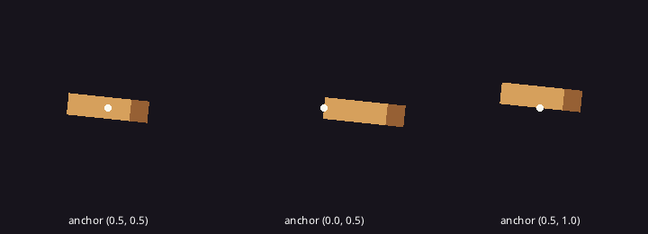

A sprite turns and scales around its `pivot`, the point of the image that sits on the `Transform`'s position: (0, 0) is the top-left corner, (1, 1) the bottom-right, and the default (0.5, 0.5) the center. Put the anchor on the joint and the part swings like a limb instead of spinning like a propeller:

```rust
{{#include ../../gallery/animation/pivot/main.cdl:pivot}}
```

For a joint at pixel (jx, jy) of a w x h image, the pivot is `vec2(jx / w, jy / h)`. `Rectangle` has the same `pivot`; a `Circle` turns around its center. [Run it in the browser](../play/gallery/animation/pivot/).

<details>
<summary>The whole program</summary>

```rust
{{#include ../../gallery/animation/pivot/main.cdl:all}}
```

</details>

### Rigs

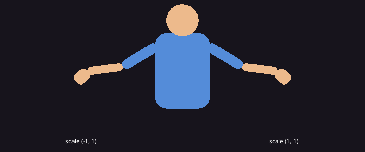

An arm is a chain of children: the upper arm hangs from the shoulder, the forearm from the upper arm, the hand from the forearm. Each child's `Transform` counts from its parent, so the forearm sits at the upper arm's end, `at(80.0, 0.0)` along its +x, and turning the upper arm carries everything below it:

```rust
{{#include ../../gallery/animation/rig/main.cdl:rig}}
```

Every joint then swings on its own, with its rotation counted from the part it hangs from:

```rust
{{#include ../../gallery/animation/rig/main.cdl:swing}}
```

A `scale.x` of -1 on the shoulder mirrors the whole arm, rotations included, so one rig and one system drive both sides. Turn a side-view character around the same way: set its root's `scale.x` to -1. The `phase` of each joint keeps them out of step; equal phases make the arm swing as one stiff piece. [Run it in the browser](../play/gallery/animation/rig/).

<details>
<summary>The whole program</summary>

```rust
{{#include ../../gallery/animation/rig/main.cdl:all}}
```

</details>

## Angles

| Function | Returns |
|----------|---------|
| `wrap_angle(a)` | `a` brought into -PI to PI |
| `angle_diff(from, to)` | The shortest turn from `from` to `to`, -PI to PI |
| `lerp_angle(a, b, t)` | From `a` toward `b` along the shorter arc |
| `rotate_towards(current, target, max_step)` | `current` turned toward `target` by at most `max_step`, the short way round |
| `look_at(from, to)` | The rotation that points +x from `from` toward `to` |
| `lerp(a, b, t)`, `move_towards(current, target, max_step)`, `smoothstep(lo, hi, x)` | Plain number helpers |
| `damp(current, target, rate, dt)`, `damp2(...)` for `Vec2` | Eases toward the target by the same share each second at any frame rate |
| `sin`, `cos`, `atan2(y, x)`, `from_angle(a)`, `Vec2.angle()`, `Vec2.rotated(a)` | Trigonometry; see [Values](../reference/values.md) |

### Turning toward a target

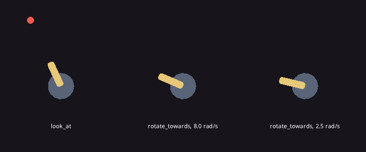

`look_at` gives the rotation that points a part's +x at a target; assigning it snaps. `rotate_towards` turns toward it by at most a step, so a turret, a head or an eye turns at a speed you choose and never jumps:

```rust
{{#include ../../gallery/animation/look/main.cdl:aim}}
```

`speed` is radians a second: 8 feels alert, 2.5 heavy. For a part with a parent, compare against its world rotation: `world_transform(e).rotation`, or turn the target into the parent's space first with `to_local`. [Run it in the browser](../play/gallery/animation/look/) and move the mouse.

<details>
<summary>The whole program</summary>

```rust
{{#include ../../gallery/animation/look/main.cdl:all}}
```

</details>

## Oscillators and wobble

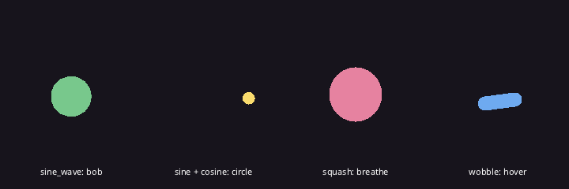

| Function | Returns |
|----------|---------|
| `sine_wave(t, frequency, amplitude, phase)`, `cosine_wave(...)` | A wave between -amplitude and amplitude, `frequency` cycles a second, shifted by `phase` radians |
| `wobble(t, frequency, amplitude, seed)`, `wobble2(...)` | Smooth random motion between -amplitude and amplitude; different seeds wobble differently |

Feed them `time.elapsed` and they give idle motion with no state to keep:

```rust
{{#include ../../gallery/animation/waves/main.cdl:waves}}
```

`frequency` is how many times a second it repeats and `amplitude` how far it goes. Give each repeated part its own `phase` (for example `float(i) * 0.6`) and a row of fins or legs moves as a wave instead of in unison. `wobble` never repeats, which reads as alive: a hovering drone, a nervous creature, a flame. [Run it in the browser](../play/gallery/animation/waves/).

<details>
<summary>The whole program</summary>

```rust
{{#include ../../gallery/animation/waves/main.cdl:all}}
```

</details>

## Squash and stretch

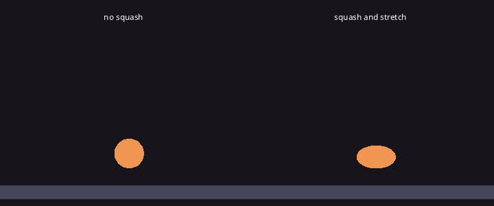

| Function | Returns |
|----------|---------|
| `squash(amount)` | A scale that keeps the area: 0.2 is taller and thinner, -0.2 shorter and wider |
| `stretch(velocity, per_speed, max_stretch)` | Longer along x the faster `velocity` is, up to `1 + max_stretch`; rotate the part to `velocity.angle()` with it |

```rust
{{#include ../../gallery/animation/bounce/main.cdl:bounce}}
```

`per_speed` sets how much each pixel a second stretches and `max_stretch` caps it; the -0.4 in `squash` is how flat the ball gets on impact. Scale a body's sprite, not the body entity, when its children should not squash along: put the sprite on a child of its own. [Run it in the browser](../play/gallery/animation/bounce/).

<details>
<summary>The whole program</summary>

```rust
{{#include ../../gallery/animation/bounce/main.cdl:all}}
```

</details>

## Springs

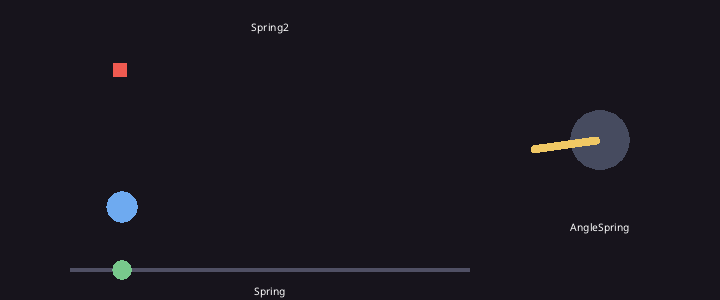

A spring chases a target with weight: it lags, overshoots and settles. Keep one in a component or resource so it carries its velocity between frames.

| Type | Methods |
|------|---------|
| `Spring` (`value`, `velocity`), made with `spring(value)` | `update(target, stiffness, damping, dt) -> float`, `smooth(target, seconds, dt) -> float` |
| `Spring2` for a `Vec2`, made with `spring2(value)` | the same, with `Vec2` targets |
| `AngleSpring` for a rotation, made with `angle_spring(value)` | `update(target, stiffness, damping, dt)`, turning the short way round |

```rust
{{#include ../../gallery/animation/springs/main.cdl:springs}}
```

```rust
{{#include ../../gallery/animation/springs/main.cdl:chase}}
```

`smooth` is critically damped in about `seconds`, for cameras and eyes. Springs stay stable at any frame time. [Run it in the browser](../play/gallery/animation/springs/).

<details>
<summary>The whole program</summary>

```rust
{{#include ../../gallery/animation/springs/main.cdl:all}}
```

</details>

### Stiffness and damping

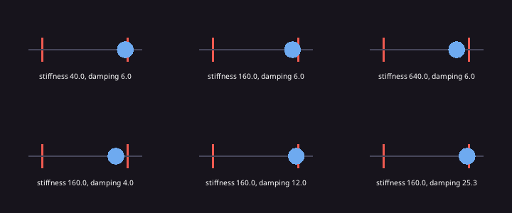

`stiffness` pulls toward the target: the top row goes from lazy (40) to snappy (640). `damping` slows it: the bottom row goes from springy (4) to a settle with no overshoot at 25.3, which is `2 * sqrt(stiffness)`, critical damping. Less damping wobbles, which is the point for antennae, ears and jiggle; try stiffness 100 to 400.

```rust
{{#include ../../gallery/animation/spring_tuning/main.cdl:chaser}}
```

[Run it in the browser](../play/gallery/animation/spring_tuning/).

<details>
<summary>The whole program</summary>

```rust
{{#include ../../gallery/animation/spring_tuning/main.cdl:all}}
```

</details>

### Secondary motion

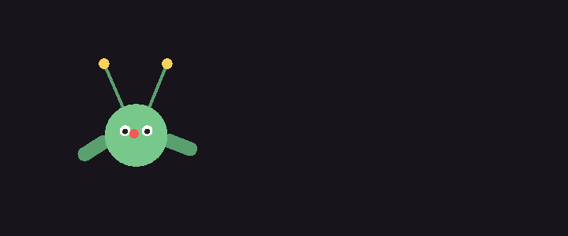

Secondary motion is a part that lags behind the part it rides on. Nobody animates it: it is a spring on where the part would be if it were rigid. Each antenna tip is a root of its own whose `Spring2` chases the point on the head it belongs to; each ear is a child of the head whose `AngleSpring` leans it against the head's velocity:

```rust
{{#include ../../gallery/animation/secondary/main.cdl:parts}}
```

A soft spring (stiffness 60 to 90, damping 3 to 5) trails and wobbles after the head stops; raise either and the parts follow more tightly. [Run it in the browser](../play/gallery/animation/secondary/) and move the mouse.

<details>
<summary>The whole program</summary>

```rust
{{#include ../../gallery/animation/secondary/main.cdl:all}}
```

</details>

## Two-bone IK

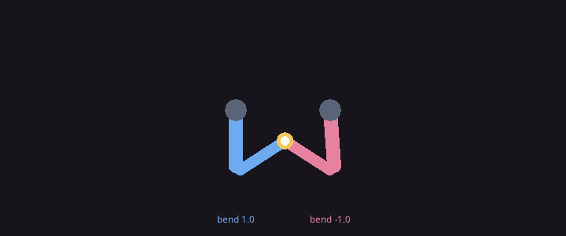

`two_bone_ik(root, target, upper_len, lower_len, bend)` poses an arm or leg of two bones from `root` toward `target` and returns a `TwoBone`: `joint` (the elbow or knee), `end` (the hand or foot), `upper` and `lower` (the world rotation of each bone), and `reached` (false when the target is out of reach; the limb then points straight at it).

```rust
{{#include ../../gallery/animation/two_bone/main.cdl:arm}}
```

`bend` 1.0 puts the joint clockwise of the root-to-target line on screen, -1.0 counter-clockwise: pick the side the knee points to, and flip it when the character turns around. Draw each bone with its pivot at its start, `pivot: vec2(0.0, 0.5)`, pointing along +x. When the bones are children of each other, as in the creature below, set local rotations instead: the thigh's is `angle_diff(body_rotation, pose.upper)` and the shin's `angle_diff(pose.upper, pose.lower)`. [Run it in the browser](../play/gallery/animation/two_bone/) and move the mouse.

<details>
<summary>The whole program</summary>

```rust
{{#include ../../gallery/animation/two_bone/main.cdl:all}}
```

</details>

## IK chains

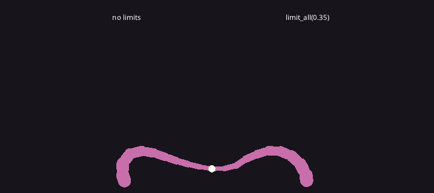

`IkChain` is FABRIK: a chain of any number of segments whose end reaches for a target while its first joint stays where you put it. Necks, tails that reach, tentacles, spines.

```rust
{{#include ../../gallery/animation/tentacle/main.cdl:chains}}
```

Each segment is drawn from its joint, turned along the chain:

```rust
{{#include ../../gallery/animation/tentacle/main.cdl:segments}}
```

| Member | Does |
|--------|------|
| `ik_chain(root, count, length, direction)` | A straight chain of `count` segments of `length` from `root`, pointing along `direction` |
| `joints`, `lengths` | The joint positions (one more than segments) and segment lengths; build your own for uneven segments |
| `solve(root, target) -> bool` | Moves the first joint to `root` and reaches; true when the end got within `tolerance` |
| `limit_all(max_bend)` | Keeps every joint within `max_bend` radians either way of the segment before it |
| `min_angles`, `max_angles`, `base_angle` | Per-joint limits; segment 0 is limited against `base_angle` |
| `iterations` (10), `tolerance` (0.5) | Solver effort and how close counts as reached |
| `end()`, `angle(i)`, `len()` | The tip, the world rotation of segment i, the segment count |

Joint limits make chains look like they have bones: with `limit_all(0.35)` the tentacle curls instead of folding back on itself, and gives up on targets it cannot reach without breaking a limit. Smaller limits make a stiffer neck. [Run it in the browser](../play/gallery/animation/tentacle/) and move the mouse.

<details>
<summary>The whole program</summary>

```rust
{{#include ../../gallery/animation/tentacle/main.cdl:all}}
```

</details>

## Ropes, tails and hair

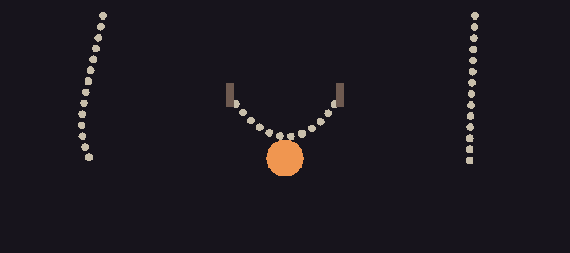

`Rope` is a verlet chain: points joined by fixed-length links, the first held at an anchor, the rest swinging under gravity. Tails, tentacles that trail, hair, scarves, cloth strips, ropes.

```rust
{{#include ../../gallery/animation/rope/main.cdl:ropes}}
```

Moving a point is all it takes to hit a rope: the rope keeps the move as speed and swings on. `pin` holds the last point as well, for a bridge or a rope tied at both ends. [Run it in the browser](../play/gallery/animation/rope/).

| Member | Does |
|--------|------|
| `rope(start, count, segment, direction)` | `count` points `segment` apart from `start` along `direction` |
| `update(anchor, dt)` | One step with the first point at `anchor` |
| `points`, `len()`, `angle(i)` | Where to draw; the rotation of link i |
| `gravity` (0, 400), `damping` (0.98), `iterations` (8) | Weight, how quickly swinging dies down, how stiff the links are |
| `stiffness` (0) | 0 hangs like a rope; toward 1 the chain resists bending, like a tail |
| `ground` | Points stay above this y |
| `pin(target)`, `release()` | Holds the last point too, as for a rope tied at both ends |
| `push(v)` | Moves every point by `v` this step: wind, a hit |

<details>
<summary>The whole program</summary>

```rust
{{#include ../../gallery/animation/rope/main.cdl:all}}
```

</details>

### Tail stiffness

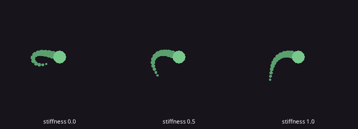

Seen from above nothing pulls a tail down, so its `gravity` is zero, and `stiffness` decides its character:

```rust
{{#include ../../gallery/animation/tail/main.cdl:tail}}
```

At 0 the tail trails like a string and bunches up when the body turns back; toward 1 it keeps its curve and sweeps round. `damping` below 1 acts as friction on the ground. [Run it in the browser](../play/gallery/animation/tail/).

<details>
<summary>The whole program</summary>

```rust
{{#include ../../gallery/animation/tail/main.cdl:all}}
```

</details>

## Stepping feet

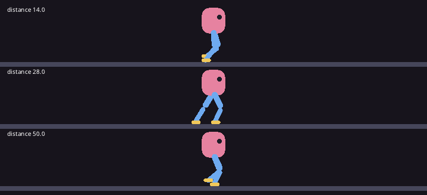

A `Foot` stays planted where it landed while the body moves on, and steps when it strays too far from where it should stand. That is the whole trick of procedural walking: the body moves smoothly, and the feet catch up in quick arcs. Each foot steps only while the other is planted, so they take turns, and two-bone IK bends each leg to reach its foot:

```rust
{{#include ../../gallery/animation/gait/main.cdl:walker}}
```

| Member | Does |
|--------|------|
| `foot(at)` | A foot planted at `at` |
| `update(rest, gait, can_step, dt) -> bool` | Advances toward `rest`, where the foot would stand now. A planted foot steps only when `can_step`. True on the frame it lands |
| `position`, `planted()` | Where to draw it; whether it is on the ground |
| `Gait` | `distance` (step when this far from rest), `duration` (seconds a step takes), `height` (lift mid-step), `lead` (land this share of `distance` past the rest point, toward where it moved, so a moving body does not leave it behind), `up` (the lift direction, (0, -1)) |

The rows differ only in `distance`: 14 shuffles in quick small steps, 50 lopes and lets the legs stretch far behind before they catch up. A shorter `duration` keeps up with a faster body. [Run it in the browser](../play/gallery/animation/gait/).

<details>
<summary>The whole program</summary>

```rust
{{#include ../../gallery/animation/gait/main.cdl:all}}
```

</details>

## Tweens on a key

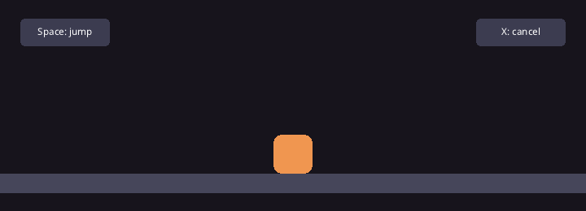

Not everything needs a system every frame. A `Tween` is fire-and-forget: insert it once and the engine plays its steps in order. Inserting another tween replaces the one playing, which is how a second key cancels the first:

```rust
{{#include ../../gallery/animation/tween/main.cdl:tween}}
```

Steps run one after another, so this jump rises, spins at the top and falls; the cancel turns the block upright and bounces it onto the floor from wherever it was. See [Tweens](movement.md#tweens) for every step and easing curve. [Run it in the browser](../play/gallery/animation/tween/): Space jumps, X cancels.

<details>
<summary>The whole program</summary>

```rust
{{#include ../../gallery/animation/tween/main.cdl:all}}
```

</details>

## Cost

The springs, solvers, ropes and feet run in the engine, one call per spring, chain, rope or foot per frame, with the state crossing as a list of numbers. Fewer points and `iterations` make a rope cheaper.

## Walkthrough: the creature

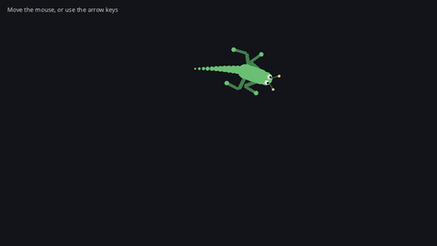

The [Creature](../examples/creature.md) example puts all of this together: a lizard that walks after the cursor. [Play it in the browser](../play/creature/). Here is how it is built, step by step.

### 1. A rig of parts

The body is an entity with a `Transform` and a `Creature` component and nothing drawn. Everything else hangs from it with `spawn_child`, so it moves and turns with the body:

```rust
let body = cmd.spawn([Transform { position: start, .. }, Creature { .. }]);
cmd.spawn_child(body, [at(0.0, 0.0), Rectangle { size: vec2(58.0, 38.0), corner_radius: 18.0, color: SKIN, z: 2.0, .. }, Breath {}]);
let head = cmd.spawn_child(body, [at(30.0, 0.0), Circle { radius: 15.0, color: SKIN, z: 3.0, .. }, Head { .. }]);
let eye = cmd.spawn_child(head, [at(6.0, 7.0 * side), Circle { radius: 5.0, .. }]);
cmd.spawn_child(eye, [at(0.0, 0.0), Circle { radius: 2.5, color: rgb(20, 20, 30), .. }, Pupil {}]);
```

The creature faces +x in its own space: the head is 30 pixels in front, and +y is its right side. Each leg is a chain of three children, thigh, shin and paw, each placed at the end of the one before; the bones are rectangles with their pivot at their left middle, `pivot: vec2(0.0, 0.5)`, so they turn around the joint:

```rust
let thigh = cmd.spawn_child(body, [Transform { position: hip, .. },
    Rectangle { size: vec2(leg.upper, 8.0), pivot: vec2(0.0, 0.5), corner_radius: 4.0, .. }, leg]);
let shin = cmd.spawn_child(thigh, [Transform { position: vec2(leg.upper, 0.0), .. },
    Rectangle { size: vec2(leg.lower, 6.0), pivot: vec2(0.0, 0.5), corner_radius: 3.0, .. }, Shin { leg: thigh }]);
cmd.spawn_child(shin, [at(leg.lower, 0.0), Circle { radius: 5.0, .. }]);
```

The body's drawing is a child of its own (`Breath`) so that breathing scales only the drawing, not the legs and head hanging from the body.

### 2. Moving the body

`move_body` moves the root toward the cursor, or the way the keys point, easing its velocity with `damp2` and turning to face where it goes with `rotate_towards`, so it never snaps around:

```rust
c.velocity = damp2(c.velocity, dir * tuning.speed, 6.0, time.dt);
t.position = t.position + c.velocity * time.dt;
if c.velocity.length() > 10.0 {
    t.rotation = rotate_towards(t.rotation, c.velocity.angle(), tuning.turn_speed * time.dt);
}
```

Every other system runs `after: [move_body]`, so they see where the body is this frame: its changes land when it returns, and `to_world` and `world_transform` read them from then on.

### 3. Breathing

```rust
let breath = squash(sine_wave(time.elapsed, 0.6, 0.06, 0.0));
let s = 1.0 + min(speed * 0.0008, 0.12);
t.scale = vec2(breath.x * s, breath.y / s);
```

A slow sine through `squash` swells and narrows the body without changing its area; the second factor stretches it along its heading the faster it runs.

### 4. A head that watches

The head turns toward the cursor relative to the body, clamped to a radian either way, on an `AngleSpring` so it overshoots a little and settles:

```rust
let want = angle_diff(body.rotation, look_at(head.position, input.mouse_world()));
t.rotation = h.turn.update(clamp(want, -1.0, 1.0), 120.0, 12.0, time.dt);
```

Each pupil is a child of its eye; `to_local` turns the cursor into the eye's space, and `clamp_length` keeps the pupil inside:

```rust
let eye = parent_of(e);
t.position = world_to_local(eye, input.mouse_world()).clamp_length(2.2);
```

### 5. Legs that step

Each `Leg` keeps a `Foot` in world space. Its rest point, where the foot would stand now, is a fixed point in the body's space carried to the world with `to_world`; the foot stays put until the body has moved far enough from it, then steps there in an arc. Legs come in two diagonal groups, and a group may only step while the other one is standing, which gives the trot:

```rust
let standing = [true, true];
for (leg, _) in legs {
    if !leg.foot.planted() {
        standing[leg.group] = false;
    }
}
for (leg, t) in legs {
    let hip = local_to_world(rig.body, leg.hip);
    leg.foot.update(local_to_world(rig.body, leg.rest), gait, standing[1 - leg.group], time.dt);
    let pose = two_bone_ik(hip, leg.foot.position, leg.upper, leg.lower, leg.bend);
    t.rotation = angle_diff(body.rotation, pose.upper);
}
```

`two_bone_ik` bends each leg to reach its foot; `bend` points the front knees back and the back knees forward. The solver answers in world rotations, and the thigh is a child of the body, so its local rotation is the difference from the body's. The shin, a child of the thigh, takes the difference from the thigh in `bend_shins`, which reads the pose through a `Lookup<Leg>`.

### 6. A tail that drags

The tail is a `Rope` in a resource, anchored behind the body. Seen from above nothing pulls it down, so `gravity` is zero; strong `damping` acts as friction on the ground and `stiffness` keeps it from folding:

```rust
rig.tail = rope(start + vec2(-26.0, 0.0), 12, 9.0, PI);
rig.tail.gravity = vec2(0.0, 0.0);
rig.tail.damping = 0.85;
rig.tail.stiffness = 0.6;
```

Each frame `swing_tail` steps it from the body's rear, `local_to_world(rig.body, vec2(-26.0, 0.0))`, and `place_tail` puts one shrinking circle on each point.

### 7. Antennae that lag

The antenna tips are roots of their own, each with a `Spring2` chasing the point where it would be on a rigid head. The spring is soft, so the tips trail behind when the head turns and wobble when it stops; a line from the base on the head to the tip draws the stalk:

```rust
let base = local_to_world(rig.head, a.base);
t.position = a.tip.update(local_to_world(rig.head, a.offset), 160.0, 7.0, time.dt);
draw.line(base, t.position, rgb(60, 110, 70), 2.0);
```

### Where to go from here

- Swap the shapes for sprites: put each bone's image on the same entity with `pivot` on its joint.
- Turn a side-view character around by setting the root's `scale.x` to -1: its children mirror with it, rotations included.
- Give a spider eight legs in four groups, or a centipede a row of legs whose phases come from `sine_wave`.
- Make a neck or a tentacle that reaches with an `IkChain`, and use `limit_all` so it curls instead of folding.
