# Procedural Generation

Random numbers you can replay, noise, level generators, weighted tables, and pathfinding over the levels they make. They are the engine's own: a seed gives the same numbers and the same levels in a Candela game, in a C++ game and in the browser.

Each picture on this page comes from the program printed under it, a small game in [`bindings/candela/docs/gallery/procgen`](https://github.com/FizzWizZleDazzle/Drift/tree/main/bindings/candela/docs/gallery/procgen). Copy the code into a game folder and it draws the same picture; `scripts/gallery.js` makes the pictures again from those programs.

| Technique | Picture |
|-----------|---------|
| [Seeds and replay](#seeds-and-replay) | The same seed, the same level |
| [Noise](#noise) and [domain warp](#domain-warp) | Value, Perlin and simplex noise, octaves, swirls |
| [Terrain](#terrain-from-noise) | An island in height bands |
| [Caves](#caves) | Cellular automata |
| [Dungeons](#dungeons) | Rooms, corridors and doors |
| [Random walk](#random-walk) | Tunnels carved by walkers, animated |
| [Wave function collapse](#wave-function-collapse) | A village from a hand-drawn sample |
| [Scattering points](#scattering-points) | Trees on a meadow |
| [Weighted tables](#weighted-tables) | Loot drops and how often each came up |
| [Make a level](#make-a-level) | Dungeon, tilemap, coins and a player, walked |
| [Finding the way](#finding-the-way) | A flow field over a cave |

## Random numbers

`rng(seed)` makes a generator. Its methods advance it, so keep it in a resource to carry on where it left off:

```rust
@resource
struct Loot { rng: Rng = rng(1234) }

@system
fn drop(loot: Loot, cmd: Commands) {
    let gold = loot.rng.range(5, 10);          // 5 to 10, both included
    if loot.rng.chance(0.15) { /* a rare drop */ }
    let spot = loot.rng.inside_circle(32.0);
}
```

| Method | Returns |
|--------|---------|
| `next_int()` | 32 random bits, 0 to 4294967295 |
| `next_float()` | 0.0 up to, not including, 1.0 |
| `below(n)` | 0 up to, not including, `n` |
| `range(lo, hi)` | An int from `lo` to `hi`, both included |
| `range_float(lo, hi)` | A float from `lo` up to `hi` |
| `chance(p)` | `true` with probability `p` |
| `sign()` | -1.0 or 1.0 |
| `angle()`, `unit_vector()` | A random direction |
| `inside_circle(r)`, `inside_rect(r)` | A point inside a shape |
| `normal(mean, stddev)` | A Gaussian sample |
| `weighted(weights)` | An index chosen in proportion to its weight; -1 when no weight is above 0 |
| `pick<T>(items)`, `shuffle<T>(items)` | A random element; the items in a random order. Name the element type: `rng.shuffle<Card>(deck)` |
| `split()` | A new generator seeded from this one, for a sub-task |
| `copy()` | A generator at the same point, to replay what this one produces next |

`rng_stream(seed, stream)` gives the same seed another sequence; `seed_from(text)` turns text, such as a seed a player typed, into a seed. Structs are shared when assigned, so `let b = a;` gives a second name for the same generator: use `a.copy()` for an independent one.

`unit_vector`, `inside_circle` and `normal` go through the platform's `sin`, `cos` and `log`, whose last bits can differ between platforms; everything else is the same everywhere.

### Seeds and replay

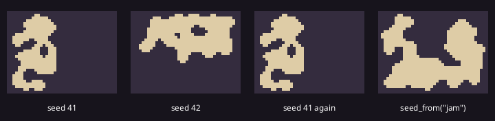

A generator made from a seed produces the same numbers every time, so a level built from it comes out the same:

```rust
{{#include ../../gallery/procgen/seeds/main.cdl:seeds}}
```

Give each kind of content its own generator, from `rng_stream(seed, n)` or `random.stream(name)` below, so that an extra roll for loot does not change the next level.

<details>
<summary>The whole program</summary>

```rust
{{#include ../../gallery/procgen/seeds/main.cdl:all}}
```

</details>

### The game's seed

`[random]` in `drift.toml` sets one seed for the whole game, and the `Random` engine resource hands it out:

```toml
[random]
seed = 1234   # 0 (the default) picks a new seed each run and logs it
```

```rust
@system(schedule: Schedule::Startup)
fn setup(random: Random, level: Level) {
    level.rng = random.stream("levels");   // the same every time for this seed
}
```

`random.seed()` is the seed in use; `random.stream(name)` is a generator for one purpose, the same for the same seed and name and independent of every other name, so rolling an extra loot drop does not change the next level. With seed 0 the log names the seed it picked; put it in `drift.toml`, or run `drift run --set random.seed=<n>`, to play the same run again.

## Noise

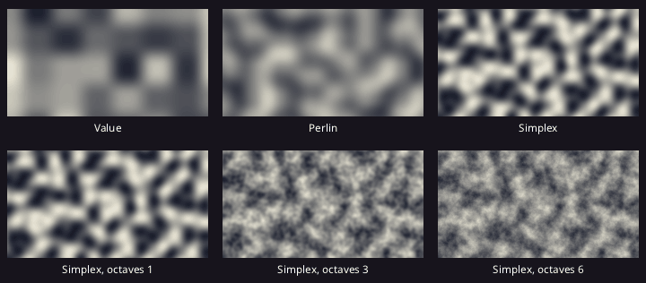

A `Noise` is a recipe for a smooth random field, with samples from -1.0 to 1.0. `Image.noise` paints one into an image, from the first color where the noise is -1 to the second where it is 1:

```rust
{{#include ../../gallery/procgen/noise/main.cdl:noise}}
```

Value noise is blocky, Perlin and simplex are smoother. Each octave adds a layer of finer detail at half the strength of the last, which is fractal Brownian motion (fBm): one octave gives soft blobs, six give ragged, cloud-like edges.

| Field | Default | Meaning |
|-------|---------|---------|
| `seed` | 0 | Different seeds give unrelated fields; `noise(seed)` makes the default recipe |
| `kind` | `NoiseType::Simplex` | `Value` (blocky), `Perlin` or `Simplex` |
| `frequency` | 1.0 | Scales positions: 0.05 makes features about 20 units across |
| `octaves`, `lacunarity`, `gain` | 1, 2.0, 0.5 | Layers of finer detail, each `lacunarity` times the frequency and `gain` times the strength of the last |
| `warp`, `warp_frequency` | 0.0, 1.0 | Bends the field by up to `warp` units along another noise field, for swirls and rivers. `warp_frequency` is that field's frequency as a multiple of `frequency` |

`sample(x, y)` reads one point. `samples(from, w, h, step)` returns `w * h` samples row by row in one call, which is much faster than calling `sample` in a loop. `grid(w, h, threshold, above, below)` makes a `Grid` with `above` where the noise at a cell's center is at least `threshold`.

<details>
<summary>The whole program</summary>

```rust
{{#include ../../gallery/procgen/noise/main.cdl:all}}
```

</details>

### Domain warp

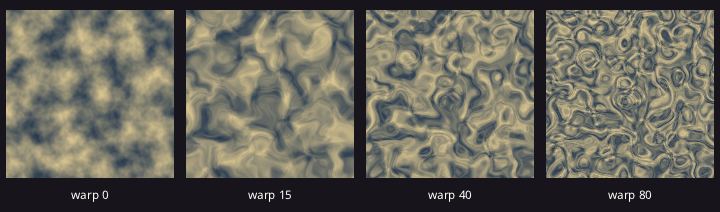

`warp` moves every sample point along a second noise field before reading the first, which turns blobs into swirls, marble and winding rivers:

```rust
{{#include ../../gallery/procgen/warp/main.cdl:warp}}
```

A warp of a few units bends the shapes; a warp larger than the features themselves folds them into marble. A `warp_frequency` below 1.0 bends in broader sweeps.

<details>
<summary>The whole program</summary>

```rust
{{#include ../../gallery/procgen/warp/main.cdl:all}}
```

</details>

### Terrain from noise

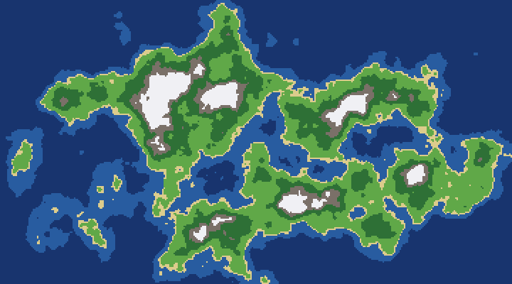

Read the heights with `samples`, then color each one by the highest band it reaches. Lowering the height toward the edges of the map turns the noise into an island:

```rust
{{#include ../../gallery/procgen/terrain/main.cdl:terrain}}
```

`LEVELS` sets how much of the map each band covers: raise the first two for more sea. `frequency` sets the size of the land masses, and `octaves` how ragged their coasts are. The same heights work for a tilemap: write a grid of band numbers and [fill](#into-a-tilemap) a layer from it.

<details>
<summary>The whole program</summary>

```rust
{{#include ../../gallery/procgen/terrain/main.cdl:all}}
```

</details>

## Grids

The generators work on a `Grid`: `width`, `height` and `cells`, an `int[]` row by row from the top-left. They write `FLOOR` (0) for open cells and `WALL` (1) for solid ones; dungeons add `DOOR` (2). Your own values can be anything.

| Member | Use |
|--------|-----|
| `grid(w, h, value)` | A grid filled with `value` |
| `get(c)`, `set(c, v)` | A cell's value (`WALL` outside the grid) |
| `in_bounds(c)`, `count(v)`, `cells_of(v)` | |
| `keep_largest_region(value, fill)` | The largest connected region of `value` stays; the others become `fill` |
| `remove_small_regions(value, min_size, fill)` | Regions under `min_size` cells become `fill` |
| `connect_regions(value, width)` | Carves tunnels until every region of `value` is joined |
| `region_sizes(value)` | The sizes of the connected regions |
| `flood_fill(from)` | A grid with 1 where `from` reaches through cells of its own value |

Cells are `Cell { x, y }`, built with `cell(x, y)`.

## Generators

Each generator takes a generator, advances it, and returns a grid of `width` x `height` cells:

```rust
let r = rng(seed);
let caves = cave(r, 60, 32, CaveOptions { fill: 0.48, .. });
let d = dungeon(r, 60, 32, DungeonOptions { max_room: 9, .. });
let tunnels = random_walk(r, 60, 32, WalkOptions { walkers: 4, brush: 2, .. });
```

### Caves

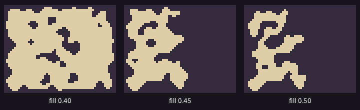

**`cave`** fills the grid with random walls and smooths it with a cellular automaton into caverns. The pictures draw each cell as one pixel:

```rust
{{#include ../../gallery/procgen/caves/main.cdl:cave}}
```

`fill` is the knob that matters most: at 0.40 the cave is one wide hall with pillars, at 0.50 it is narrow winding passages. Every cavern but the largest is filled in, so the floor that is left is always connected.

| `CaveOptions` field | Default | Meaning |
|---------------------|---------|---------|
| `fill` | 0.45 | Chance a cell starts as wall. Higher gives narrower caves |
| `steps` | 5 | Smoothing passes |
| `birth`, `survive` | 5, 4 | Wall neighbours (of 8) that make a wall, and that keep one |
| `solid_edges` | `true` | The outer ring is always wall |
| `keep_largest` | `true` | Every cavern but the largest is filled, so the whole cave is reachable |

<details>
<summary>The whole program</summary>

```rust
{{#include ../../gallery/procgen/caves/main.cdl:all}}
```

</details>

### Dungeons

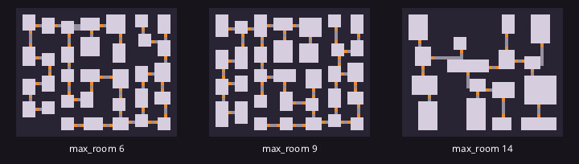

**`dungeon`** splits the area into partitions (binary space partitioning, BSP), puts a room in each and joins them with corridors, so every room is reachable. It returns a `Dungeon` with the `grid` and the `rooms`, each a `GridRect` (`x`, `y`, `w`, `h`, `center()`, `contains(c)`):

```rust
{{#include ../../gallery/procgen/dungeon/main.cdl:dungeon}}
```

Small rooms fill the map with many little chambers; large ones give a few halls joined by long corridors.

| `DungeonOptions` field | Default | Meaning |
|------------------------|---------|---------|
| `min_room`, `max_room` | 4, 10 | Room side in cells |
| `padding` | 1 | Wall kept around each room inside its partition |
| `corridor_width` | 1 | |
| `extra_corridors` | 2 | Corridors between nearby rooms on top of the ones that join them all; they make loops |
| `doors` | `true` | `DOOR` where a corridor enters a room |

<details>
<summary>The whole program</summary>

```rust
{{#include ../../gallery/procgen/dungeon/main.cdl:all}}
```

</details>

### Random walk

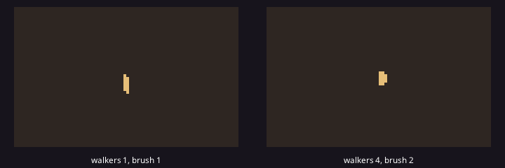

**`random_walk`** starts from solid wall and lets walkers wander, carving floor, until a share of the cells is open. The animation walks the same seed again each step with a higher `coverage`, so you see the tunnels grow:

```rust
{{#include ../../gallery/procgen/random_walk/main.cdl:walk}}
```

One walker with a thin brush makes long, maze-like tunnels; several walkers with a wider brush make open, blobby caves. [Run it in the browser](../play/gallery/procgen/random_walk/).

| `WalkOptions` field | Default | Meaning |
|---------------------|---------|---------|
| `coverage` | 0.4 | Stop once this share of the cells is floor |
| `walkers` | 1 | |
| `turn_chance` | 0.4 | Chance per step to turn |
| `brush` | 1 | Carves `brush` x `brush` cells per step |
| `start` | middle | Start cell; `cell(-1, -1)` is the middle |

<details>
<summary>The whole program</summary>

```rust
{{#include ../../gallery/procgen/random_walk/main.cdl:all}}
```

</details>

### Wave function collapse

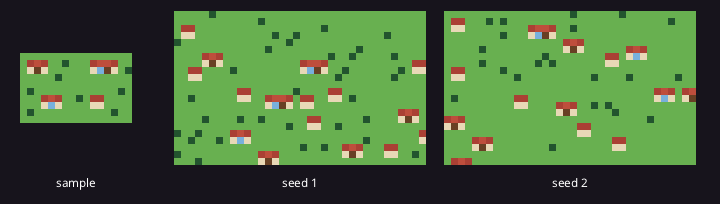

`wfc(rng, sample, width, height, options)` builds a grid in which every pair of neighbouring values also sits side by side somewhere in `sample`, with values about as common as there. Draw a small example of the layout you want and it makes more of it:

```rust
{{#include ../../gallery/procgen/wfc/main.cdl:wfc}}
```

The sample never shows a roof without walls under it, or a wall without a roof above, so every house inside the map is whole; only the edges cut some off. Give each part of a structure its own value, as the roof and wall pieces here, and the output keeps the structure together.

| `WfcOptions` field | Default | Meaning |
|--------------------|---------|---------|
| `attempts` | 10 | Restarts after a contradiction |
| `periodic` | `false` | Neighbours wrap around the edges |
| `preset` | empty | A grid of the output size: a cell holding a value from the sample is fixed to it, any other value (such as -1) leaves it free. For solid borders, entrances, or a room you placed by hand |

It returns `None` when every attempt contradicted itself. It only learns which values sit next to which, so it copies the sample's local texture rather than its large structures; run `keep_largest_region` when the result must be one connected area.

<details>
<summary>The whole program</summary>

```rust
{{#include ../../gallery/procgen/wfc/main.cdl:all}}
```

</details>

### Scattering points

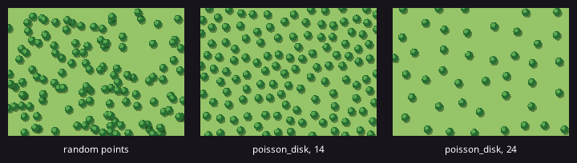

`poisson_disk(rng, area, min_distance)` returns points in a `Rect` no closer than `min_distance` to each other: even, without a pattern, for trees, rocks and spawn points.

```rust
{{#include ../../gallery/procgen/poisson/main.cdl:poisson}}
```

The first panel has as many trees as the second, at plain random points: they overlap in places and leave gaps in others. `min_distance` sets the density.

`poisson_on_grid(rng, g, value, min_distance)` does the same over the cells of `g` holding `value`, in cell units, so multiply by your cell size:

```rust
for p in poisson_on_grid(r, level.grid, FLOOR, 4.0) {
    cmd.spawn([at(p.x * 16.0, p.y * 16.0), Coin { .. }]);
}
```

<details>
<summary>The whole program</summary>

```rust
{{#include ../../gallery/procgen/poisson/main.cdl:all}}
```

</details>

## Weighted tables

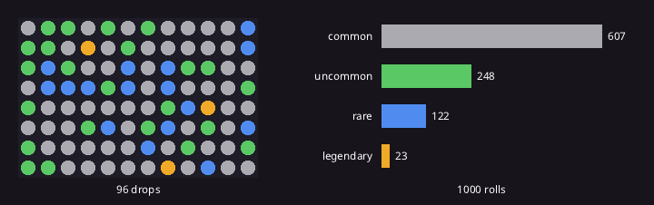

A weighted table rolls an item in proportion to its weight:

```rust
{{#include ../../gallery/procgen/loot/main.cdl:loot}}
```

Weights are relative: 60, 25, 12 and 3 add up to 100, so a common item comes up about 60 times in 100 rolls. An entry with weight 0 or less never comes up, and `roll` returns `None` when no entry can. Items can be any type, such as strings or enum variants.

<details>
<summary>The whole program</summary>

```rust
{{#include ../../gallery/procgen/loot/main.cdl:all}}
```

</details>

## Into a tilemap

`Assets.create_tilemap` makes an empty map, and `Map.fill` writes a grid into one of its layers through a table of tile ids, one per value:

```rust
level.map = assets.create_tilemap(60, 32, 16, art.tiles, ["Floor", "Walls"]);
level.map.fill(0, floor, [0, 1, 2], cell(0, 0));   // value 1 -> tile 1, 2 -> tile 2
level.map.fill(1, caves, [0, 3], cell(0, 0));      // FLOOR stays empty, WALL is tile 3
level.map.set_layer_solid(1, true, [3]);           // walls become colliders
cmd.spawn([at(0.0, 0.0), Tilemap { map: level.map, .. }]);
```

See [Levels and Tilemaps](levels-and-tilemaps.md#maps-made-in-code).

## Make a level

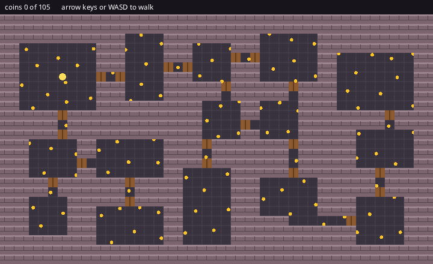

The pieces together: a dungeon from the game's seed, written into a tilemap whose walls collide, coins on Poisson-disk points over the floor, and a player in the first room. All of it happens in one startup system:

```rust
{{#include ../../gallery/procgen/level/main.cdl:level}}
```

The rest of the program draws the three tiles, moves the player and counts the coins. `drift.toml` fixes the seed, so this level comes up every run; set `[random] seed` to 0 for a new one each time. [Play it in the browser](../play/gallery/procgen/level/), and see [Cave Walk](../examples/cave-walk.md) and [Roguelike](../examples/roguelike.md) for whole games built this way.

<details>
<summary>The whole program</summary>

```rust
{{#include ../../gallery/procgen/level/main.cdl:all}}
```

```toml
{{#include ../../gallery/procgen/level/drift.toml}}
```

</details>

## Finding the way

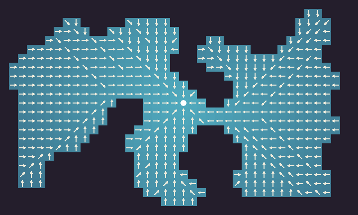

`find_path(g, start, goal, blocked, diagonal)` returns the cells from `start` to `goal`, both included, through cells whose value is not in `blocked`; it is empty when there is no way. `diagonal` allows diagonal steps that do not cut corners.

A flow field answers "which way to the goal" for every cell at once, so one field steers any number of chasers. The picture draws the `direction` of every open cell as an arrow and its `cost` as brightness:

```rust
{{#include ../../gallery/procgen/flow_field/main.cdl:flow}}
```

In a game, each chaser reads the direction of the cell it stands on:

```rust
level.field = flow_field(level.grid, [player_cell], [WALL], true);
// later, for each chaser:
velocity.linear = level.field.direction(cell_of(t.position)) * 55.0;
```

| `FlowField` method | Returns |
|--------------------|---------|
| `direction(c)` | A unit vector toward the next step; zero at a goal or where no goal is reachable |
| `direction_at(pos, cell_size)` | The same for a world position, with cells `cell_size` wide from the origin |
| `step(c)` | The neighbour one step closer |
| `cost(c)` | Steps to the nearest goal; -1.0 when none is reachable |

Build the field again when the goal moves to another cell, not every frame. The grid crosses to the engine on every `find_path` and `flow_field` call, so for large grids, compute paths when something changes rather than per entity per frame.

<details>
<summary>The whole program</summary>

```rust
{{#include ../../gallery/procgen/flow_field/main.cdl:all}}
```

</details>

## Steering

Steering behaviors move agents smoothly toward or away from things: the engine's `steer_*` functions each return a force, a change of velocity per second. Add the ones you want with weights, cap the sum, and integrate into the `Velocity`:

```rust
@component
struct Chaser { wander: Wander = Wander { .. } }

@system
fn chase(chaser: (Chaser, Transform, Velocity), time: Time, dice: Dice,
         players: (Player, Transform)[]) {
    let (c, t, v) = chaser;
    let force = steer_wander(v.linear, c.wander, dice.rng, 90.0) * 0.3;
    for (_, p) in players {
        force = force + steer_arrive(t.position, v.linear, p.position, 90.0, 48.0);
    }
    v.linear = steer_truncate(v.linear + steer_truncate(force, 300.0) * time.dt, 90.0);
}
```

| Function | Steers |
|----------|--------|
| `steer_seek(pos, vel, target, max_speed)`, `steer_flee(pos, vel, threat, max_speed, panic_radius)` | Toward a point at full speed; away from one while it is within `panic_radius` (0: always) |
| `steer_arrive(pos, vel, target, max_speed, slow_radius)` | Toward a point, slowing inside `slow_radius` to stop on it |
| `steer_pursue(pos, vel, target, target_vel, max_speed)`, `steer_evade(...)` | Toward or away from where a moving target will be |
| `steer_separation(pos, neighbours, radius, max_speed)`, `steer_cohesion(pos, vel, neighbours, radius, max_speed)`, `steer_alignment(pos, vel, positions, velocities, radius, max_speed)` | Flocking: apart from close neighbours, toward their middle, along their heading |
| `steer_wander(vel, wander, rng, max_speed)` | Aimless but smooth; `Wander` (`angle`, `distance`, `radius`, `jitter`) is the agent's state, kept in a component |
| `steer_follow_path(pos, vel, path, follow, max_speed)` | Along a list of points, arriving at the last; `PathFollow` (`index`, `reach_radius`, `slow_radius`) is the agent's place on it. Feed it the cells of `find_path` turned into world positions |
| `steer_truncate(v, max_length)` | `v` shortened to at most `max_length`, for capping forces and speeds |

The `Spatial` resource finds the neighbours for the flocking behaviors.

## Seeing

`field_of_view(g, from, radius, opaque)` returns a grid of the same size with 1 on every cell `from` sees within `radius` cells and 0 elsewhere. Cells whose value is in `opaque` block sight and are seen themselves, so the walls of a room show around its floor. The view is symmetric: when the player sees a monster, the monster sees the player.

```rust
@system
fn fog_of_war(level: Level, players: (Player, Transform)[]) {
    for (_, t) in players {
        let at = cell(int(t.position.x / 16.0), int(t.position.y / 16.0));
        let seen = field_of_view(level.grid, at, 8, [WALL]);
        for i in range(seen.cells.len()) {
            if seen.cells[i] == 1 {
                level.explored.cells[i] = 1;   // remembered once seen
            }
        }
    }
}
```

`line_of_sight(g, a, b, opaque)` says whether one cell sees another, for a guard deciding whether it spotted the player, and `grid_line(a, b)` lists the cells of the straight line between two cells, for aiming and thrown objects on a grid.

The [Cave Walk](../examples/cave-walk.md) and [Roguelike](../examples/roguelike.md) examples put all of this together. See [Procedural Generation](../reference/procgen.md) in the reference for every type and function.
