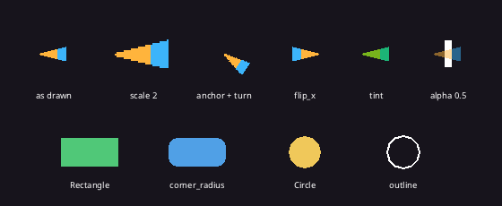

# Sprites, Shapes and Images

Everything you see is a component: put a `Sprite`, `Rectangle`, `Circle` or `Text` on an entity with a `Transform`, and the engine draws it every frame. There is no draw call to write. For text and the HUD, see [UI and Score](ui-and-score.md); for what the screen shows, see [Cameras](cameras.md).

## Sprites



A sprite draws a texture at its entity's position. To show an image from a file:

1. Put the file in the game folder, for example `assets/cone.png`. PNG, JPEG, BMP, TGA and GIF files load; everything under `assets/` goes into the web page.
2. Load it with `texture(path)`. The path is relative to the game folder. The first call loads the file; later calls with the same path give back the same texture, so calling it in a Startup system or every time you spawn costs the same.
3. Spawn an entity with a `Transform` (here from `at(x, y)`) and a `Sprite` whose `image` is the texture.

```rust
{{#include ../../gallery/sprites/basics/main.cdl:sprites}}
```

[Run it in the browser](../play/gallery/sprites/basics/).

<details>
<summary>The whole program</summary>

```rust
{{#include ../../gallery/sprites/basics/main.cdl:all}}
```

</details>

A path that does not exist logs `loadTexture: cannot read 'assets/ship.png'` and throws. The throw reaches your code as the error `host_fn_error`, without the path in it, so `catch "drift_load_failed"` does not match it; use `catch e`. Uncaught, it stops the system that called `texture` (the rest of that Startup system does not run, so whatever it would have spawned is missing), logs `setup raised host_fn_error: ... drift_load_failed: assets/ship.png`, and the game keeps running. In a resource's field default, such as `struct Art { ship: Texture = texture("assets/ship.png") }`, a missing file stops the whole game before it starts, with "The game could not start" and `Art: building its defaults raised host_fn_error` on the page. To fall back instead:

```rust
let ship = Texture { .. };   // no texture: the sprite draws nothing
try {
    ship = texture("assets/ship.png");
} catch e {
    warn("no ship image: " + e);
}
```

A `Sprite` with no image (`Texture { .. }`) draws nothing; to draw a plain box, use a `Rectangle`.

`Assets.create_texture(w, h, pixels)` makes a texture from colors instead, and a render target is a texture too. Textures sample with `Filter::Nearest` by default, which keeps pixel art crisp; call `set_filter(Filter::Linear)` for smooth scaling.

- `frame` draws part of the image, as a `Rect` in pixels. A zero-size rect draws all of it. Sprite sheets hand out these rects; see [Sprite sheets](#sprite-sheets).
- `pivot` is the point of the image placed at the position, from (0, 0) top-left to (1, 1) bottom-right. The default (0.5, 0.5) centers it. The sprite turns and scales around it.
- `color` tints the image and its `a` sets the opacity: `color: rgb(255, 255, 255).alpha(0.5)` draws it half transparent. `flip_x` and `flip_y` mirror it, `blend` picks how it mixes with what is behind it (`Blend::Additive` for glows).
- `Transform.rotation` (radians, clockwise on screen) and `Transform.scale` turn and size the sprite around its pivot. A negative scale mirrors it as well.

To turn a limb around its joint rather than its middle, put the pivot on the joint. For an arm image 64 pixels wide whose shoulder is at its left edge, halfway down:

```rust
cmd.spawn([
    Transform { position: vec2(200.0, 150.0), rotation: 0.6, .. },
    Sprite { image: texture("assets/arm.png"), pivot: vec2(0.0, 0.5), .. },
]);
```

For a joint at pixel (jx, jy) of a w x h image, the pivot is `vec2(jx / w, jy / h)`. With a `frame`, count from the frame's top-left and use its size.

## Shapes

`Rectangle` and `Circle` draw filled shapes, or only their outline, `outline` pixels thick, when `outline` is above zero. They need no image:

```rust
{{#include ../../gallery/sprites/basics/main.cdl:shapes}}
```

| Field | Default | Unit | Meaning |
|-------|---------|------|---------|
| `Rectangle.size` | (32, 32) | pixels | Width and height |
| `Rectangle.corner_radius` | 0.0 | pixels | Rounds the corners |
| `Rectangle.anchor` | (0.5, 0.5) | 0 to 1 | The point placed at the position, as for a sprite |
| `Circle.radius` | 16.0 | pixels | |
| `color` | white | `Color` | Fill, or outline color |
| `outline` | 0.0 | pixels | Above 0 draws only the outline, this thick |
| `z`, `layer`, `visible` | 0.0, 0, true | | Draw order and hiding, as below |

An entity draws one of `Sprite`, `Rectangle` or `Circle`, plus any `Text`. For a shape made of several parts, spawn several entities and give the parts a `Parent`.

## Draw order and layers

Every drawable has a `layer` and a `z`. Higher layers draw over lower ones; within a layer, higher `z` draws on top. World layers are 0 to 30, and cameras draw the layers in their `layer_mask`, every world layer (`ALL_LAYERS`) by default. `layer_mask([0, 3])` builds a mask, for example for a minimap camera that leaves out the decoration on layer 2.

`hud_layer()` is the screen layer. It draws last, after post effects, in screen coordinates without a camera: (0, 0) is the top-left of the window's logical area. Put scores, menus and health bars there (see [UI and Score](ui-and-score.md)):

```rust
cmd.spawn([at(16.0, 16.0), Text { value: "Lives 3", size: 24.0, layer: hud_layer(), .. }]);
```

Set `visible: false` to hide a drawable without removing it.

## Sprite sheets

A sprite sheet is one image holding many frames in a grid. `assets.spritesheet(texture, frame_w, frame_h)` cuts it, and a sprite shows one frame through its `frame` field:

```rust
let sheet = assets.spritesheet(texture("assets/hero.png"), 16.0, 16.0);
cmd.spawn([at(100.0, 100.0), Sprite { image: sheet.texture, frame: sheet.frame(0, 0), .. }]);
```

Frames count from 0 at the top-left, left to right, then down. `frame(col, row)` and `frame_at(i)` hand out one frame's rect, and `count()` is how many there are. `assets.aseprite(path)` loads an Aseprite file with its frame durations and tags. To play frames over time, give the entity an `Animator` with clips of the sheet's frames; see [Movement](movement.md#animation-frames).

## Images

An `Image` is pixels you change from code: fill it, draw shapes and other images into it, set single pixels, then show it with `to_texture()`. Keep the texture and call `texture.update_rect(image, r)` after each change; it uploads only that part, so painting every frame stays cheap in the browser.

```rust
let img = assets.create_image(128, 128, rgb(0, 0, 0));
img.vertical_gradient(rgb(40, 0, 80), rgb(255, 120, 0));
img.circle(vec2(64.0, 64.0), 24.0, rgba(255, 255, 255, 200));
cmd.spawn([at(200.0, 200.0), Sprite { image: img.to_texture(), .. }]);
```

A texture's `to_image()` reads its pixels back from the GPU: for a render target, what its camera drew. `save_png` or `download` keeps them. See [`Image`](../reference/assets.md#image) for every method. [Save and Load](../examples/save-load.md) paints on a grid, and the [Roguelike](../examples/roguelike.md) draws its tileset this way.

## Parts that move together

A `Parent` makes an entity's `Transform` count from another entity: its position, rotation and scale are relative to the parent, so when the parent moves, turns or scales, the child goes with it. Chains of parents make a rig, such as a body, an upper arm, a forearm and a hand. `cmd.spawn_child(parent, bundle)` spawns one:

```rust
@component struct Joint { speed: float = 1.0 }

@system(schedule: Schedule::Startup)
fn build_arm(cmd: Commands) {
    let arm = texture("assets/arm.png");   // 64 x 12, shoulder at the left edge
    let body = cmd.spawn([at(200.0, 240.0), Rectangle { size: vec2(40.0, 60.0), .. }]);
    let upper = cmd.spawn_child(body, [at(15.0, -20.0), Sprite { image: arm, pivot: vec2(0.0, 0.5), .. }, Joint { speed: 1.0 }]);
    let fore = cmd.spawn_child(upper, [at(64.0, 0.0), Sprite { image: arm, pivot: vec2(0.0, 0.5), .. }, Joint { speed: 2.0 }]);
    cmd.spawn_child(fore, [at(64.0, 0.0), Circle { radius: 8.0, .. }]);   // the hand, at the forearm's end
}

@system
fn swing(joint: (Joint, Transform), time: Time) {
    let (j, t) = joint;
    t.rotation = 0.6 * sin(time.elapsed * j.speed);
}
```

Each part's position is where its joint sits on the parent, in the parent's own units: the forearm is at (64, 0) because the upper arm is 64 pixels long. Setting the root's `scale` to (-1, 1) mirrors the whole rig, children's rotations included, which turns a character around.

- `GlobalTransform` is a part's place in the world after every parent. Query it like any component; assign to it to put a part at a world position, and the engine works out the local `Transform`.
- `world_transform(e)`, `local_to_world(e, local)` and `world_to_local(e, world)` convert between the world and an entity's space at any time, from the engine's current transforms. A system's own changes land when it returns, so these see them from the next system on.
- `parent_of(e)`, `children_of(e)` and `descendants_of(e)` walk the tree.
- `cmd.set_parent(child, parent)` and `cmd.set_parent_in_place(child, parent)` move an entity under another, the second keeping it where it is on screen; `cmd.detach(child)` makes it a root again where it is.
- Despawning an entity despawns everything below it.

The engine composes the transforms after the Update systems and before drawing, every frame.

## Shaders

A sprite with a `material` draws through a shader of your own: a hit flash, a dissolve, water. Write the fragment stage in GLSL, the `main` of a shader that sets `o_color`; the engine adds the inputs `v_uv`, `v_color`, `v_world`, the textures `u_texture0` to `u_texture3`, and `material.params[0]` to `[7]`. The browser and desktop OpenGL run GLSL; add a `.wgsl` file beside it for the WebGPU backend.

```rust
const FLASH: string = "void main() {
    vec4 c = texture(u_texture0, v_uv) * v_color;
    o_color = vec4(mix(c.rgb, material.params[0].rgb, material.params[0].a), c.a);
}";

@system(schedule: Schedule::Startup)
fn setup(cmd: Commands, assets: Assets) {
    let flash = assets.create_material(assets.create_shader("", FLASH));
    flash.set_color(0, rgba(255, 255, 255, 180));
    cmd.spawn([at(200.0, 200.0), Sprite { image: texture("assets/enemy.png"), material: flash, .. }]);
}
```

`assets.shader("shaders/flash")` loads `shaders/flash.frag.glsl` and `shaders/flash.wgsl` instead. A material can also run over the whole picture as a post effect with `effects.add_material(material, order)`; the picture arrives as `u_texture0`.

See [Engine Components](../reference/components.md#sprite) for every field.


See [Engine Components](../reference/components.md#sprite) for every field.
