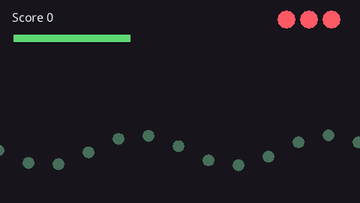

# UI and Score

A score, a health bar, a menu: the HUD is entities on `hud_layer()`, the screen layer. It draws last, in screen pixels, not through a camera, so it stays put while the world scrolls and shakes. This page covers text, keeping a score, the `drift/ui` widget module, and drawing without entities.

## Before you start

- HUD entities need `layer: hud_layer()`. Without it, text and shapes are part of the world: once the game has a camera they scroll, zoom and shake with it.
- A HUD position is in screen pixels from the top-left of the game's logical size (`width` and `height` in `[window]`), whatever the camera does.
- The widgets need `import "drift/ui" { * };` beside `import "drift" { * };`.
- A font of your own is loaded before the widgets that use it are made; see [Fonts](#fonts).



The program behind the picture binds three widgets to one resource, and changes only the resource. [Run it in the browser](../play/gallery/ui/hud/).

```rust
{{#include ../../gallery/ui/hud/main.cdl:hud}}
```

<details>
<summary>The whole program</summary>

```rust
{{#include ../../gallery/ui/hud/main.cdl:all}}
```

</details>

## Text on screen

```rust
@system(schedule: Schedule::Startup)
fn setup(cmd: Commands) {
    // A title on the HUD, centered at the top.
    cmd.spawn([at(640.0, 20.0), Text { value: "Level 1", size: 40.0, align: Align::Center,
                                       outline: 2.0, layer: hud_layer(), .. }]);
    // A sign in the world, seen through the camera.
    cmd.spawn([at(300.0, 180.0), Text { value: "SHOP", color: rgb(255, 220, 120),
                                        align: Align::Center, valign: VAlign::Middle, .. }]);
}
```

`align` and `valign` choose which point of the text sits on the position; it is also the point the text rotates around. On `hud_layer()` the position is in screen pixels; on world layers it is in world units.

A `Text` holds up to 511 bytes. For a longer page of dialog, split it across several entities.

## Changing the string

Take the text as a parameter and assign `value`:

```rust
@component
struct ScoreLabel {}

@system
fn show_score(label: (ScoreLabel, Text), score: Score) {
    let (_, text) = label;
    text.value = "Score " + string(score.value);
}
```

## Style

| Field | Effect |
|-------|--------|
| `size` | Pixel height. Raise it for bigger text instead of scaling the `Transform`, so the glyphs stay sharp |
| `color` | Text color |
| `wrap` | Wraps lines at this width; 0 for no wrapping |
| `line_spacing` | Multiplies the distance between lines |
| `outline`, `outline_color` | An outline of this width around each glyph |
| `shadow_offset`, `shadow_color` | A drop shadow; a zero offset turns it off |
| `rich_text` | Reads inline color tags |

With `rich_text: true`, `[color=#rrggbb]` or `[color=#rrggbbaa]` switches the color until the matching `[/color]`. Tags nest, and `[[` writes a literal `[`:

```rust
Text { value: "Press [color=#ffd060]E[/color] to open", rich_text: true, layer: hud_layer(), .. }
```

`Transform.scale` stretches the drawn glyphs, which suits short animations such as a pop-in.

## Fonts

Text uses the built-in font unless `font` names another. To use your own:

1. Put the font file in the game folder, for example `assets/fonts/title.ttf`. Everything under `assets/` goes into the web page.
2. Load it once in a Startup system with `assets.font(path, size)` and keep the `Font` in a resource. `size` is the size in pixels a `Text` with `size: 0.0` draws at; a `Text` with its own `size` draws at that size.
3. Set `font` on each `Text` that should use it. Systems that spawn text from it run `after:` the loading system.

```rust
@resource
struct Fonts { title: Font = Font { .. } }   // the built-in font until loaded

@system(schedule: Schedule::Startup)
fn load_fonts(assets: Assets, fonts: Fonts) {
    fonts.title = assets.font("assets/fonts/title.ttf", 48.0);
}

@system(schedule: Schedule::Startup, after: [load_fonts])
fn spawn_title(cmd: Commands, fonts: Fonts) {
    cmd.spawn([at(200.0, 60.0), Text { value: "My Game", font: fonts.title, size: 48.0, align: Align::Center, .. }]);
}
```

For the `drift/ui` widgets, set the theme's font in the same Startup system, before any widget is made; widgets copy the theme when they are created:

```rust
@system(schedule: Schedule::Startup)
fn load_fonts(assets: Assets, fonts: Fonts, theme: Theme) {
    fonts.title = assets.font("assets/fonts/title.ttf", 48.0);
    theme.font = fonts.title;
}
```

`assets.font` loads TrueType (`.ttf`), OpenType (`.otf`) and BMFont (`.fnt` with its page images) files, each path once. TrueType and OpenType fonts stay smooth at any `size`; BMFont files suit pixel-art fonts drawn at their own size. The size is a float; an int such as `48` converts to one.

A path that does not exist logs an error and throws `"drift_load_failed: <path>"`. The whole string is the error, so `catch "drift_load_failed"` does not match it; catch it with `catch e` to fall back to the built-in font:

```rust
let title = Font { .. };
try {
    title = assets.font("assets/fonts/title.ttf", 48.0);
} catch e {
    warn("using the built-in font: " + e);
}
```

## Measuring

`font.measure(s, size)` gives the width of the widest line and the height of a string, and `text.measure()` the same for a `Text` with its own font, size, wrap and spacing; use them to fit a box around a label or center a menu. `font.line_height(size)` is the distance between lines. Characters a font lacks come from the built-in font, or from another with `font.set_fallback(other)`.

```rust
let size = fonts.title.measure("Game Over", 48.0);
draw.hud();
draw.rect(rect(320.0 - size.x * 0.5 - 8.0, 100.0, size.x + 16.0, size.y), rgba(0, 0, 0, 160));
```

`Draw.text_styled(s, pos, style)` draws a string for one frame with any `Text` value as the style.

See [Engine Components](../reference/components.md#text) for every field.

## Formatting numbers

Scores, timers and prices need more than `string(x)`:

| Function | Returns |
|----------|---------|
| `format(pattern, args)` | The pattern with each `{}` replaced by the next argument and `{0}`, `{1}` by the argument at that index: `format("{} of {}", [3, 10])` is `"3 of 10"`. `{{` and `}}` write a brace |
| `format_named(pattern, values)` | The pattern with each `{name}` replaced by `values[name]`: `format_named("Hi {who}", {"who": "Ana"})` |
| `fixed(x, decimals)` | A float with exactly that many decimals: `fixed(3.14159, 2)` is `"3.14"` |
| `pad(n, width)` | An int with leading zeros: `pad(7, 3)` is `"007"` |
| `grouped(n)` | An int with thousands separated by commas: `"12,345"` |
| `format_clock(seconds)` | A time as `"m:ss"`, or `"h:mm:ss"` from an hour up: `format_clock(75.0)` is `"1:15"` |
| `format_clock_tenths(seconds)` | The same with a digit of tenths: `format_clock_tenths(75.25)` is `"1:15.2"` |

```rust
text.value = format("Lap {}  {}  Best {}", [lap, format_clock_tenths(race.time), format_clock_tenths(race.best)]);
```

For text in several languages, see [Localization](localization.md).

## Keeping score

The score is a [resource](../concepts/resources.md); a label is an entity with a `Text` and a tag; one small system copies one into the other:

```rust
@resource
struct Score { value: int = 0, best: int = 0 }

@component struct ScoreLabel {}

@system(schedule: Schedule::Startup)
fn hud(cmd: Commands) {
    cmd.spawn([at(16.0, 12.0), Text { size: 28.0, outline: 2.0, layer: hud_layer(), .. }, ScoreLabel {}]);
}

@system
fn show_score(label: (ScoreLabel, Text), score: Score) {
    let (_, text) = label;
    text.value = "Score " + string(score.value) + "    Best " + string(score.best);
}
```

Systems that score change the resource and need to know nothing about the label. Keep the best score in [save data](saving.md) so it lasts between visits. A label that shows only in some phases sets `text.visible` from the [state](../concepts/states.md), as the banners in the examples do.

Text that rises and fades where something happened is an entity with a `Velocity` and a `Lifetime`:

```rust
cmd.spawn([at(p.x, p.y - 16.0), Text { value: "+10", size: 20.0, align: Align::Center, .. },
           Velocity { linear: vec2(0.0, -60.0), .. }, Lifetime { seconds: 0.6 }]);
```

## The drift/ui module

`drift/ui` is a set of HUD and menu widgets: labels bound to your resources, health and progress bars, icon rows, buttons, toggles, sliders, toasts and typing dialog boxes. Import it next to `drift`, and its systems run the widgets for you:

```rust
import "drift" { * };
import "drift/ui" { * };

@resource
struct Game { score: int = 0, hp: float = 100.0, max_hp: float = 100.0, lives: int = 3 }

@system(schedule: Schedule::Startup)
fn hud(cmd: Commands, theme: Theme) {
    cmd.spawn(plus(label(theme, "", anchor(TOP_LEFT, 16.0, 12.0)), [bind_counter<Game>("score", "Score {}", 200.0)]));
    spawn_bar(cmd, theme, anchor(TOP_LEFT, 16.0, 48.0), vec2(220.0, 18.0),
              Bar { value_from: resource_field<Game>("hp"), max_from: resource_field<Game>("max_hp"), .. });
    cmd.spawn(plus(icon_row(anchor(TOP_RIGHT, -110.0, 14.0), 3, 3), [IconRow { count_from: resource_field<Game>("lives"), .. }]));
}
```

The score counts up when it changes, the bar follows `Game.hp` with a trail that shows the damage taken, and the hearts follow `Game.lives`, without a system of your own.

Every widget draws on `hud_layer()`: in screen pixels, after the game and its post effects, and not through a camera, so screen shake and zoom leave it alone. A game that does not import `drift/ui` carries none of it.

### Anchors

An `Anchor` keeps an entity at a point of the window plus an offset in pixels, and keeps it there when the window changes size:

```rust
anchor(TOP_RIGHT, -16.0, 16.0)     // 16 pixels in from the top-right corner
Anchor { to: CENTER, offset: vec2(0.0, -80.0) }
```

The points are `TOP_LEFT`, `TOP`, `TOP_RIGHT`, `LEFT`, `CENTER`, `RIGHT`, `BOTTOM_LEFT`, `BOTTOM` and `BOTTOM_RIGHT`, or any `Vec2` from (0, 0) at the top-left to (1, 1) at the bottom-right. Widgets also use the point as their pivot: a label anchored at `TOP_RIGHT` is right-aligned, so it grows to the left.

Positions are in the window's logical pixels. When `drift.toml` keeps a fixed logical size and the page scales it to fit, the HUD scales with the game and stays the same size relative to it; clicks and taps arrive in the same logical pixels.

Phones put notches and rounded corners over the edges. `safe_margin` in the theme keeps every anchored widget that many pixels inside each edge.

For several widgets in a line, `row`, `column` and `grid_layout` return the offsets:

```rust
let spots = column(vec2(0.0, -80.0), 56.0, 3);   // three offsets 56 pixels apart
button(cmd, theme, Anchor { to: CENTER, offset: spots[0] }, "play", "Play", 0);
button(cmd, theme, Anchor { to: CENTER, offset: spots[1] }, "options", "Options", 1);
button(cmd, theme, Anchor { to: CENTER, offset: spots[2] }, "quit", "Quit", 2);
```

### Themes

`Theme` is the look widgets start from: font, text size and color, outline and shadow, panel, button and bar colors, padding, corner radius, widget width and the safe margin. It is a settings resource, so `drift.toml` can set it:

```toml
[theme]
text_size = 26.0
corner_radius = 10.0
accent = { r = 1.0, g = 0.6, b = 0.2, a = 1.0 }
safe_margin = { x = 12.0, y = 12.0 }
```

A widget copies the theme when it is made. For one widget that looks different, pass a changed copy: `theme.sized(40.0)`, `theme.colored(rgb(255, 210, 60))` or `theme.accented(rgb(240, 80, 90))`. To restyle a widget after it is made, change its components (`Text`, `Rectangle`, `Bar`) from a system.

### Labels and bindings

`label(theme, text, anchor)` is a bundle: a `Text` in the theme's style with an `Anchor`. Add components to it with `plus`.

`Bind` fills a label from a field of one of your resources. `bind_text<Game>("level", "Level {}")` names the resource by its type and the field by name, with dots for a field of a struct field (`"player.hp"`), and `format` puts the value where `{}` is:

```rust
cmd.spawn(plus(label(theme, "", anchor(TOP_LEFT, 16.0, 12.0)), [bind_text<Game>("level", "Level {}")]));
cmd.spawn(plus(label(theme, "", anchor(TOP_LEFT, 16.0, 40.0)), [bind_counter<Game>("coins", "{} coins", 50.0)]));
```

The compiler checks that `Game` is a type. The field name is checked when the binding is made: a type that is not a resource raises `drift_not_a_resource`, and a field it does not have raises `drift_no_such_field` with the fields it does have, so a typo shows in the log at once instead of as an empty label.

`bind_counter` counts toward a new number at the given speed, in units per second, or faster for a large change, instead of jumping. `decimals` sets how many decimals a number shows. `ClockBind` shows a field holding seconds as `m:ss`, or `m:ss.d` with `tenths`, for timers:

```rust
cmd.spawn(plus(label(theme.sized(30.0), "", anchor(TOP, 0.0, 12.0)), [ClockBind { source: resource_field<Game>("time_left"), .. }]));
```

`format_clock(seconds)` makes the same text yourself. Every binding reads its field through a `ResourceField`, made with `resource_field<Game>("score")`; its `text()` and `number()` read the field from any system.

### Panels, bars and icon rows

`panel(theme, anchor, size)` is a rounded rectangle in the theme's panel color, to put behind other widgets.

`spawn_bar(cmd, theme, anchor, size, bar)` makes a bar and returns its entity. A `Bar` fills to `value / max`; set those from a system, or bind them with `value_from` and `max_from`, each a `resource_field<Game>("hp")`. The fill slides to a new value (`smooth`, per second; 0 jumps), and after a drop a trail in `trail_color` holds for `trail_delay` seconds, then shrinks to the fill. Colors left unset come from the theme.

```rust
let stamina = spawn_bar(cmd, theme.accented(rgb(90, 170, 255)), anchor(TOP_LEFT, 16.0, 72.0), vec2(160.0, 10.0),
                        Bar { value_from: resource_field<Player>("stamina"), max: 100.0, trail_delay: 0.0, .. });
```

`icon_row(anchor, count, max)` draws `max` icons with the first `count` lit: hearts, ammo, lives. Set `image` for a texture, or leave it for circles; `full` and `empty` color the lit and unlit ones, and `count_from`, a `resource_field<Game>("lives")`, binds the count.

### Buttons, toggles and sliders

```rust
@system(schedule: Schedule::Startup)
fn menu(cmd: Commands, theme: Theme) {
    button(cmd, theme, anchor(CENTER, 0.0, -40.0), "play", "Play", 0);
    toggle(cmd, theme, anchor(CENTER, 0.0, 16.0), "music", "Music", true, 1);
    slider(cmd, theme, anchor(CENTER, 0.0, 72.0), "volume", "Volume", 0.8, 0.0, 1.0, 2);
}

@system
fn on_button(p: ButtonPressed, state: State<Screen>) {
    if p.id == "play" {
        state.set(Screen::Playing);
    }
}

@system
fn on_volume(s: SliderChanged, settings: Options) {
    settings.volume = s.value;
}
```

Each widget answers its entity and sends a message when used: `ButtonPressed { id, button }`, `ToggleChanged { id, on, toggle }` or `SliderChanged { id, value, slider }`.

They work with every input:

- Mouse and touch: hover, press and release over a button; drag a slider's knob.
- Keyboard and gamepad: Up and Down (W and S, the d-pad, the left stick) move the focus through the visible widgets in their `order`; Return, Space or the South button presses; Left and Right (A and D, the d-pad, the stick) move a focused slider.

`UiFocus` holds the focused `order` (-1 until someone navigates). Set `enabled` to false to turn keyboard and gamepad navigation off while the game uses those keys.

### Showing and hiding

`Reveal` fades and slides a label or panel in and out. Set `shown`, and it moves between its anchor offset (shown) and the offset plus `slide` (hidden) over `seconds`, fading as it goes; a hidden widget stops drawing.

```rust
cmd.spawn(plus(label(theme, "Paused", anchor(CENTER, 0.0, 0.0)), [reveal(false, vec2(0.0, -40.0))]));

@system
fn show_pause(reveal: (Reveal, PauseLabel), state: State<Screen>) {
    let (rv, _) = reveal;
    rv.shown = state.now == Screen::Paused;
}
```

Bars and buttons fade their parts along with their background `Rectangle`, so fading the background fades the whole widget.

Widget animations use the frame time before the time scale, so they keep moving while the game is paused or slowed.

### Toasts

`toast(cmd, theme, message)` shows a line of text under the top of the window for a few seconds. Newer toasts stack below older ones and the rest close up when one goes.

### Dialog boxes

`dialog_box(cmd, theme, id, pages)` opens a box along the bottom of the window that types its pages out. Return, Space, a click or the South button shows the rest of a page at once, then turns to the next; after the last page the box closes and sends `DialogClosed { id, dialog }`.

```rust
dialog_box(cmd, theme, "intro", ["The bridge is out.", "Find another way across."]);
```

`Typewriter` is the typing on its own: put it on any `Text` with the `full` string and `chars_per_second`; `finished` turns true when all of it shows.

### Parts

A widget made of several shapes (a bar's fill and trail, a button's label, a slider's knob) keeps them as part entities with `PartOf`. Despawn the widget's entity and its parts go with it.

### Over the world

`FollowWorld { target, offset }` keeps an anchored widget where the camera shows an entity, plus `offset` pixels: names over heads, "Press E" prompts, bars over enemies. The widget goes when the target goes.

```rust
cmd.spawn(plus(label(theme.sized(16.0), "Shopkeeper", anchor(TOP_LEFT, 0.0, 0.0)),
               [FollowWorld { target: npc, offset: vec2(0.0, -40.0) }]));
```

`OffscreenArrow { target }` draws an arrow at the edge of the window pointing at an entity while the camera does not show it; `color`, `size` and `margin` style it.

`Radar { center, range, radius }` on an anchored entity draws a round radar: every entity with a `RadarBlip { color, size }` within `range` world units of `center` shows as a dot.

```rust
cmd.spawn([Transform { .. }, anchor(BOTTOM_LEFT, 90.0, -90.0), Radar { center: player, range: 1200.0, .. }]);
cmd.spawn(plus(enemy(pos), [RadarBlip { .. }]));
```

### Images in the HUD

`nine_slice_panel(image, border, anchor, size)` frames a panel with an image cut in nine: the corners keep their size and the edges and middle stretch, so one small image frames any size. `NineSlice` is the component, with `frame` for part of an image, `border` for each side, `color` and `z`.

`icon_label(cmd, theme, icon, text, anchor)` puts an icon before a line of text: coins, ammo, keys. Its `IconOf` component sets the icon's `size` and `gap`.

### What it does not do

Buttons, toggles and sliders are rounded rectangles; they do not take nine-slice images or icons. `safe_margin` is a fixed number; the page does not read a phone's own safe-area insets.

See [drift/ui](../reference/ui.md) for every widget and field.

## Drawing without entities

`Draw` draws shapes, text and images for one frame. Call it from a system every frame you want them shown. It suits health bars over enemies, aim lines, selection boxes, previews and debugging:

```rust
@system
fn health_bars(enemies: (Enemy, Health, Transform)[], draw: Draw) {
    for (_, h, t) in enemies {
        let r = rect(t.position.x - 16.0, t.position.y - 28.0, 32.0, 4.0);
        draw.rect(r, rgb(60, 20, 20));
        draw.rect(rect(r.x, r.y, r.w * float(h.hp) / float(h.max), r.h), rgb(220, 60, 60));
    }
    draw.hud();
    draw.text("Wave 3", vec2(16.0, 500.0), 20.0, rgb(255, 255, 255));
}
```

Draws are in world coordinates, over entities, until `hud()` switches to screen coordinates; `world()` switches back, and `on_layer` and `at_z` place them among entities. `Draw` also has outlines, rounded rects, arcs, polygons, styled text, images, nine-slices and clipping; see [`Draw`](../reference/resources.md#draw).
